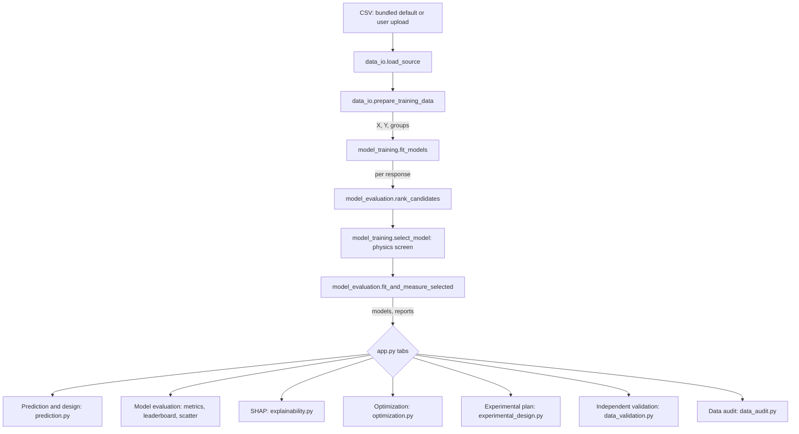

# Expansive Soil Stabilization Research DSS — Technical Documentation

**An AI-assisted decision-support system for stabilizing expansive clay with lime, rice husk ash and recycled PET fibres**

|                              |                                                                                                                                       |
| ---------------------------- | ------------------------------------------------------------------------------------------------------------------------------------- |
| **Document type**            | Technical documentation for Master's thesis chapters (Methodology, Software Architecture, Results)                                    |
| **Researcher**               | Eng. Mohamed Hassan                                                                                                                   |
| **Supervisor**               | Prof . Dr. Walid elkamash and Prof. Dr. Azza mobaruk                                                                                  |
| **Institution**              | Suez Canal University, Faculty of Engineering                                                                                         |
| **Document version**         | 1.0                                                                                                                                   |
| **Date**                     | 7 November 2026                                                                                                                       |
| **Code base described**      | `app.py`, the `soil_stabilization/` package (10 modules plus `__init__.py`) and `scripts/` (2 scripts), as delivered in this project  |
| **Verification environment** | Python 3.12.3; Streamlit 1.67.0, NumPy 2.5.4, pandas 3.1.1, scikit-learn 1.9.1, XGBoost 3.4.1, SHAP 0.54.1, pymoo 0.6.2, SciPy 1.18.1 |

> **Data provenance statement (read first).** Every numerical result quoted in Sections 10 and 11 was produced on the project's **default dataset, `data/realistic_stabilization_data.csv`, which is synthetic**: it was generated by a physics-based simulation (`scripts/generate_realistic_dataset.py`), not measured in a laboratory. Those results demonstrate that the software pipeline works and behaves in a physically plausible way. They are **not** experimental findings about real expansive soil and must not be presented as such. When verified laboratory data become available, re-run the pipeline and replace the figures in Section 10. A suggested thesis wording is given in Appendix F.

---

## Table of contents

0. [Reading guide and mapping to thesis chapters](#0-reading-guide-and-mapping-to-thesis-chapters)
1. [Introduction, scope and design principles](#1-introduction-scope-and-design-principles)
2. [System architecture](#2-system-architecture)
3. [Technology stack](#3-technology-stack)
4. [Repository structure and module reference](#4-repository-structure-and-module-reference)
5. [Runtime behaviour, module interaction and caching](#5-runtime-behaviour-module-interaction-and-caching)
6. [Data model and ingestion](#6-data-model-and-ingestion)
7. [Machine-learning methodology](#7-machine-learning-methodology)
8. [Application functional specification (tab by tab)](#8-application-functional-specification-tab-by-tab)
9. [Statistical metrics and chart interpretation guide](#9-statistical-metrics-and-chart-interpretation-guide)
10. [Results on the default (synthetic) dataset](#10-results-on-the-default-synthetic-dataset)
11. [Validity, limitations and future work](#11-validity-limitations-and-future-work)
12. [Reproducibility and operations](#12-reproducibility-and-operations)

- [Appendix A — Symbols and glossary](#appendix-a--symbols-and-glossary)
- [Appendix B — Configuration constants](#appendix-b--configuration-constants)
- [Appendix C — Random seeds](#appendix-c--random-seeds)
- [Appendix D — Command reference](#appendix-d--command-reference)
- [Appendix E — Troubleshooting](#appendix-e--troubleshooting)
- [Appendix F — Suggested thesis wording](#appendix-f--suggested-thesis-wording)
- [Appendix G — Defense preparation: likely questions](#appendix-g--defense-preparation-likely-questions)
- [References](#references)

---

## 0. Reading guide and mapping to thesis chapters

| Thesis chapter                             | Use these sections                  | Typical content                                                                          |
| ------------------------------------------ | ----------------------------------- | ---------------------------------------------------------------------------------------- |
| Methodology — data and experimental design | 6, 8.6, 8.8, Appendix F             | Variables, units, data requirements, Latin-hypercube screening plan, data audit          |
| Methodology — machine learning             | 7, 9.1–9.4                          | Candidate models, grouped splitting, cross-validated ranking, physics screening, metrics |
| Methodology — optimization and explanation | 8.4, 8.5                            | NSGA-II formulation, cost and carbon objectives, SHAP                                    |
| Software architecture                      | 1–5, 12                             | Layers, modules, dependencies, caching, reproducibility                                  |
| Results                                    | 10 (and 9.5–9.7 for interpretation) | Dataset statistics, leaderboards, hold-out and independent validation, physics checks    |
| Discussion and limitations                 | 11                                  | Threats to validity, synthetic-data caveat, future work                                  |
| Appendices                                 | A–G                                 | Symbols, constants, seeds, commands, defense questions                                   |

**Conventions.** Code identifiers, file names and column names appear in `monospace`. Equations use LaTeX notation (`$...$`). "Response" means a measured outcome (for example UCS); "input" means a model feature. Units: percentages by dry mass of soil, strengths and pressures in kPa, density in g/cm³, lengths in mm, time in days. Citations are listed in the References; check each against the original source before final submission.

---

## 1. Introduction, scope and design principles

### 1.1 Purpose

The Expansive Soil Stabilization Research DSS is a **Streamlit web application** that supports a research workflow for treating expansive (swelling) clay with **hydrated lime**, **rice husk ash (RHA)** and **recycled polyethylene terephthalate (PET) fibres**. It combines:

1. dataset loading, validation and auditing;
2. per-response supervised regression with automatic model comparison and physics-aware model selection;
3. interactive prediction of engineering responses and an exploratory bearing-pressure estimate;
4. local explanation of individual predictions (SHAP);
5. multi-objective mixture search (NSGA-II) balancing strength, swell and cost (optionally carbon);
6. generation of a space-filling laboratory screening plan;
7. prospective validation against independent laboratory measurements.

### 1.2 Scope and non-goals

The system is a **research prototype**. It does not certify mixtures, does not replace laboratory testing or geotechnical design, and does not compute design bearing capacity. Its predictions are empirical interpolations of the supplied data and are reliable only inside the range of that data.

### 1.3 Design principles

| Principle                       | How it appears in the code                                                                                                                          |
| ------------------------------- | --------------------------------------------------------------------------------------------------------------------------------------------------- |
| **Separation of concerns**      | `app.py` contains page layout only; all computation lives in `soil_stabilization/` modules with narrow responsibilities.                            |
| **No invented data**            | Responses or inputs absent from the loaded file are reported as missing; the app never fabricates predictions for them (`app.py`, `data_io.py`).    |
| **Leakage-aware evaluation**    | Replicates of one mixture are kept on the same side of every split when a grouping column exists (`model_training.py`).                             |
| **Fair model comparison**       | All candidates are ranked with the same cross-validation folds on the training portion only; the hold-out set is used once (`model_evaluation.py`). |
| **Physical plausibility**       | A monotonic-trend screen rejects models whose predicted trends contradict expected soil behaviour (`model_training.py`).                            |
| **Honest uncertainty**          | Error bands come from observed hold-out errors and are labelled as empirical, not as guaranteed intervals.                                          |
| **Reproducibility**             | Every stochastic component uses a fixed seed (Appendix C).                                                                                          |
| **Transparency of data origin** | Synthetic data carry a `Data_Origin` flag and trigger an on-screen warning (`app.py`).                                                              |

---

## 2. System architecture

### 2.1 Layered view

```text
┌──────────────────────────────────────────────────────────────────────┐
│  PRESENTATION LAYER                       app.py  +  branding.py     │
│  page shell, sidebar, 7 tabs, warnings, thesis header/footer         │
├──────────────────────────────────────────────────────────────────────┤
│  APPLICATION / DOMAIN LAYER                soil_stabilization/       │
│  data_io · data_audit · model_training · model_evaluation            │
│  prediction · explainability · optimization                          │
│  experimental_design · data_validation                               │
├──────────────────────────────────────────────────────────────────────┤
│  LIBRARY LAYER   pandas · NumPy · scikit-learn · XGBoost · SHAP      │
│                  pymoo · SciPy · Streamlit (UI + cache)              │
├──────────────────────────────────────────────────────────────────────┤
│  DATA LAYER      data/*.csv · templates/*.xlsx · assets/logos/       │
├──────────────────────────────────────────────────────────────────────┤
│  TOOLING         scripts/generate_realistic_dataset.py               │
│                  scripts/verify_models.py                            │
└──────────────────────────────────────────────────────────────────────┘
```

### 2.2 End-to-end data flow



### 2.3 Interaction pattern

Streamlit re-executes `app.py` from top to bottom on every user interaction. The heavy step (training) is wrapped in a cache, so interaction cost is dominated by lightweight prediction. Long-running actions (SHAP, optimization, plan generation) run only when their button is pressed. Details are in Section 5.

---

## 3. Technology stack

### 3.1 Runtime and libraries

The `requirements.txt` file lists ten packages **without version pins**. The versions in the table are those present in the verification environment; for a thesis, record your own `pip freeze` output (Appendix D) so results can be reproduced exactly.

| Library          | Version verified                    | Imported by                                                                                             | Architectural role in the DSS                                                                                                                                                                                                                                                                                                                                                     |
| ---------------- | ----------------------------------- | ------------------------------------------------------------------------------------------------------- | --------------------------------------------------------------------------------------------------------------------------------------------------------------------------------------------------------------------------------------------------------------------------------------------------------------------------------------------------------------------------------- |
| **Python**       | 3.12.3 (dev container targets 3.11) | all                                                                                                     | Language runtime. README requires 3.11 or newer.                                                                                                                                                                                                                                                                                                                                  |
| **Streamlit**    | 1.67.0                              | `app.py`, `data_io.py`, `model_training.py`, `branding.py`                                              | Web UI framework and reactive execution model. Provides widgets (file uploader, sliders, number inputs, tabs, buttons, metrics, data tables, scatter and bar charts, download buttons) and the two caches (`st.cache_data`, `st.cache_resource`).                                                                                                                                 |
| **pandas**       | 3.1.1                               | `app.py`, most modules                                                                                  | Tabular data structure for datasets, model inputs/outputs, summaries, leaderboards and exported CSV files; descriptive statistics (`describe`), correlation (`corr`), duplicate detection, quantiles.                                                                                                                                                                             |
| **NumPy**        | 2.5.4                               | `model_training.py`, `prediction.py`, `optimization.py`, `experimental_design.py`, `data_validation.py` | Numerical arrays; trend curves, bearing-capacity trigonometry, cost/carbon vector products, random permutation for run order.                                                                                                                                                                                                                                                     |
| **scikit-learn** | 1.9.1                               | `model_training.py`, `model_evaluation.py`, `data_validation.py`                                        | The regression engine: estimators (linear, polynomial pipeline, tree, forest, extra trees, SVR, MLP, Gaussian process, histogram gradient boosting), preprocessing (`StandardScaler`, `PolynomialFeatures`), splitting (`GroupShuffleSplit`, `GroupKFold`, `KFold`, `train_test_split`), cross-validation (`cross_val_score`), metrics (MAE, RMSE, R²), `clone`, `make_pipeline`. |
| **XGBoost**      | 3.4.1                               | `model_training.py` (optional import)                                                                   | Gradient-boosted decision-tree candidate (`XGBRegressor`). If the package is missing the candidate is silently skipped.                                                                                                                                                                                                                                                           |
| **SHAP**         | 0.54.1                              | `explainability.py` (lazy import)                                                                       | Model-agnostic local explanations through `PermutationExplainer`; `shap.sample` selects the background rows.                                                                                                                                                                                                                                                                      |
| **pymoo**        | 0.6.2                               | `optimization.py` (lazy import)                                                                         | Multi-objective evolutionary optimization: `NSGA2`, `Problem`, `minimize`.                                                                                                                                                                                                                                                                                                        |
| **SciPy**        | 1.18.1                              | `experimental_design.py` (lazy import); `scripts/`                                                      | `scipy.stats.qmc.LatinHypercube` for the screening plan; `scipy.stats.spearmanr` in the verification script. Also a dependency of scikit-learn, SHAP and pymoo.                                                                                                                                                                                                                   |
| **Matplotlib**   | 3.11.2                              | _not imported by current code_                                                                          | Listed in `requirements.txt`; available for producing thesis figures outside the app.                                                                                                                                                                                                                                                                                             |
| **seaborn**      | 0.13.2                              | _not imported by current code_                                                                          | Listed in `requirements.txt`; available for thesis figures (for example correlation heat maps).                                                                                                                                                                                                                                                                                   |

Standard-library modules used: `io` (in-memory CSV bytes), `pathlib` (portable paths), `warnings` (suppressing convergence/fit warnings during ranking), `base64` and `html` (embedding logos and escaping text in `branding.py`), `argparse` (script options).

### 3.2 Development and deployment configuration

| Item                                                 | Content                                                                                                                                                                                  |
| ---------------------------------------------------- | ---------------------------------------------------------------------------------------------------------------------------------------------------------------------------------------- |
| `.devcontainer/devcontainer.json`                    | Python 3.11 Debian dev container; installs `requirements.txt` and Streamlit; forwards port 8501 and starts `streamlit run app.py` after attach (GitHub Codespaces or VS Code).           |
| `.gitignore`                                         | Excludes `.venv/`, `venv/`, `__pycache__/`, `*.pyc`, `.idea/`, `.streamlit/secrets.toml` and `data/private/`.                                                                            |
| `templates/Verified_Experimental_Data_Template.xlsx` | Four sheets: _Read Me_, _Experimental Data_ and _Validation Data_ (header row of recognised columns, 200 data rows), and _Column Guide_. Export a sheet as CSV (UTF-8) before uploading. |

---

## 4. Repository structure and module reference

### 4.1 File inventory

```text
Expansive Soil Stabilization Research DSS/
├── app.py                              Streamlit entry point (page shell + 7 tabs)

├── README.md                           Overview and Windows setup
├── requirements.txt                    Unpinned dependency list
├── .gitignore
├── .devcontainer/devcontainer.json     Codespaces / dev-container definition
├── assets/logos/                       University and faculty logo slots (+ README.md)
├── data/
│   ├── soil_stabilization_dataset.csv           DEFAULT training data (SYNTHETIC, 504 rows)
├── docs/
│   ├── Documentation.md                This document
│   ├── USER_MANUAL.md                  User manual
├── soil_stabilization/                 Application logic (no page layout)
│   ├── __init__.py                     Package marker
│   ├── branding.py                     Thesis header, logos, sidebar credit, footer
│   ├── data_io.py                      Schema, column matching, loading, preparation
│   ├── data_audit.py                   Dataset summaries
│   ├── model_training.py               Candidate models, physics screening, training pipeline
│   ├── model_evaluation.py             CV ranking, hold-out metrics, chart frames
│   ├── prediction.py                   Prediction helper, footing-pressure estimate
│   ├── explainability.py               Local SHAP explanation
│   ├── optimization.py                 NSGA-II mixture search
│   ├── experimental_design.py          Latin-hypercube screening plan
│   └── data_validation.py              Independent validation metrics
└── templates/Verified_Experimental_Data_Template.xlsx
```

### 4.2 Module reference

Each entry lists responsibility, public interface, inputs/outputs, and dependencies.

#### 4.2.1 `app.py` — presentation and orchestration (293 lines)

Builds the page and wires the modules together. It imports one or more functions from every module in `soil_stabilization/`. It owns no scientific logic. Section 5.1 gives the execution order and Section 8 specifies each tab.

#### 4.2.2 `soil_stabilization/data_io.py` — schema and ingestion

| Item                               | Description                                                                                                                                                                                                           |
| ---------------------------------- | --------------------------------------------------------------------------------------------------------------------------------------------------------------------------------------------------------------------- |
| Constants                          | `DATA_DIR`, `DATA_FILE` (default CSV), `LEGACY_DATA_FILE`, `FEATURES` (10 canonical inputs), `FEATURE_LABELS`, `TARGETS` (10 responses: label + aliases), `GROUP_COLUMNS`, `ALIASES` (input aliases).                 |
| `norm_name(value)`                 | Lower-cases a header and removes every non-alphanumeric character. `"Lime_%"`, `"lime %"` and `"LIME"` normalise to `lime` variants for matching.                                                                     |
| `resolve_column(columns, aliases)` | Returns the first original column whose normalised name equals a normalised alias, or `None`.                                                                                                                         |
| `load_source(upload_bytes)`        | Cached. Reads the uploaded bytes or, if none, `DATA_FILE`. Returns `(DataFrame, source label)`.                                                                                                                       |
| `prepare_training_data(raw)`       | Resolves columns, applies the rules of Section 6.3 and returns `(X, Y, groups, available_features, available_targets, group_column)`; raises `ValueError` with a user-readable message when requirements are not met. |
| Depends on                         | pandas, Streamlit (cache decorator), standard library.                                                                                                                                                                |

#### 4.2.3 `soil_stabilization/data_audit.py` — dataset summaries

`summarize_dataset(X, Y, features, targets)` returns four objects: the input description table (pandas `describe` plus a `Missing` column), the response description table, the Pearson correlation block (inputs as rows, responses as columns), and the count of duplicated input rows. Depends on pandas only.

#### 4.2.4 `soil_stabilization/model_training.py` — candidates, screening, pipeline

| Item                                                              | Description                                                                                           |
| ----------------------------------------------------------------- | ----------------------------------------------------------------------------------------------------- |
| `PHYSICAL_TRENDS`                                                 | Dictionary of expected response directions per input (Section 7.6).                                   |
| `TREND_REVERSAL_TOLERANCE`                                        | 0.10 — maximum tolerated reversal as a fraction of an input's total effect.                           |
| `PHYSICS_MODEL_NAME`                                              | `"Physics-constrained GBM"`.                                                                          |
| `candidate_models(n_rows, target, feature_names)`                 | Builds the dictionary of unfitted estimators (Section 7.2).                                           |
| `trend_reversal(model, X, trends, ...)`                           | Quantifies physical-trend violation of a fitted model.                                                |
| `select_model(leaderboard, candidates, X_train, y_train, target)` | Walks the CV ranking and returns the first physically plausible model plus the screening scores.      |
| `fit_models(X, Y, groups_tuple)`                                  | Cached. For every response: split, rank, screen, evaluate, refit; returns `(fitted_models, reports)`. |
| Depends on                                                        | `model_evaluation`, scikit-learn, XGBoost (optional), NumPy, pandas, Streamlit.                       |

#### 4.2.5 `soil_stabilization/model_evaluation.py` — ranking and metrics

| Function                                                         | Description                                                                                                                                                                                                                |
| ---------------------------------------------------------------- | -------------------------------------------------------------------------------------------------------------------------------------------------------------------------------------------------------------------------- |
| `rank_candidates(candidates, X_train, y_train, cv, group_train)` | Five-fold (or fewer, see 7.3) cross-validated negative-MAE scoring of every candidate; returns a list of `{"Model", "CV MAE"}` sorted ascending. Passes `groups` when grouping is active; suppresses warnings; `n_jobs=1`. |
| `fit_and_measure_selected(...)`                                  | Clones and fits the selected estimator on the training split, predicts the hold-out split, computes the metric dictionary, then clones and fits a final model on **all** rows.                                             |
| `metrics_frame(report)`                                          | One-row table of hold-out metrics for display.                                                                                                                                                                             |
| `measured_prediction_frame(report)`                              | Two-column table (`Measured`, `Predicted`) for the scatter chart.                                                                                                                                                          |

#### 4.2.6 `soil_stabilization/prediction.py`

`predict_responses(models, row)` returns `{response: float}`. `simplified_allowable_pressure(c, φ, B, Df, γ, FS)` evaluates the exploratory general-shear formula of Section 8.2.3.

#### 4.2.7 `soil_stabilization/explainability.py`

`calculate_local_shap(model, X, row, feature_labels)` returns a table of `Input` and `SHAP value`, sorted ascending by value (Section 8.4).

#### 4.2.8 `soil_stabilization/optimization.py`

`search_pareto_candidates(X, row, models, prices, carbon_factors, min_ucs, max_swell, generations, target_labels)` formulates and solves the three-variable NSGA-II problem and returns `(candidate table or None, feasible count)` (Section 8.5).

#### 4.2.9 `soil_stabilization/experimental_design.py`

`generate_screening_plan(X, features, targets, target_labels, n_runs, replicates)` returns the laboratory plan table (Section 8.6).

#### 4.2.10 `soil_stabilization/data_validation.py`

`evaluate_validation(validation, features, targets, aliases, target_defs, models, resolve_column)` returns per-response MAE, RMSE, R² and bias (Section 8.7).

#### 4.2.11 `soil_stabilization/branding.py` — thesis identity

Holds the credit text constants (`PROJECT_TITLE`, `PROJECT_SUBTITLE`, `THESIS_LABEL`, `RESEARCHER`, `SUPERVISOR`, `UNIVERSITY`, `FACULTY`) and four rendering functions: `render_header()` (banner with two logo slots), `render_sidebar_credit()`, `render_footer()`, and the internal logo lookup that embeds `assets/logos/suez_canal_university.*` and `assets/logos/faculty_of_engineering.*` as base64 images (`.png`, `.jpg`, `.jpeg`, `.webp`, `.svg`) or shows a labelled placeholder when a file is absent. All injected text passes through `html.escape`.

#### 4.2.12 `scripts/generate_realistic_dataset.py`

Generates the synthetic training and validation files. It first asserts 99 monotonic-trend checks on the noise-free response model and aborts if any fails. Public pieces: `noise_free_responses(...)`, `make_soils(...)`, `make_dataset(seed, ...)`, `check_physics()`. Details of the physics are in `data/DATASET_README.md` and Section 10.1.

#### 4.2.13 `scripts/verify_models.py`

Trains the pipeline on the default file and prints (1) hold-out accuracy per response, (2) a trend check using soil-consistent sweeps on three representative soils, and (3) accuracy on the independent validation file. It is the executable evidence behind Section 10.

---

## 5. Runtime behaviour, module interaction and caching

### 5.1 Execution order of `app.py`

1. `st.set_page_config` (title, icon, wide layout), then `render_header()` and `render_sidebar_credit()`.
2. Research-prototype warning.
3. Sidebar file uploader; `load_source` is called with the uploaded bytes or `None`. A failure shows an error and stops the script.
4. If a `Data_Origin` column contains the word _SYNTHETIC_, a synthetic-data warning is shown.
5. `prepare_training_data` (errors shown and script stopped).
6. `fit_models` (cached; error shown and script stopped on failure).
7. Caption with dataset name, row count, number of inputs and trainable responses; information boxes listing recognised-schema responses or inputs that are absent from the data.
8. Creation of the seven tabs. **Streamlit executes the code of all tabs on every rerun**, even for tabs not currently visible.
9. Tab 1 builds the sidebar input widgets and the one-row DataFrame `row`. Tabs 3 and 4 reuse `row` (and the models), so the SHAP and optimization tabs depend on the current sidebar values.
10. `render_footer()`.

### 5.2 Module dependency matrix

Rows import columns (✔ = direct import).

| Importer ↓ / Imported → | data_io | data_audit | model_training | model_evaluation | prediction | explainability | optimization | experimental_design | data_validation | branding |
| ----------------------- | :-----: | :--------: | :------------: | :--------------: | :--------: | :------------: | :----------: | :-----------------: | :-------------: | :------: |
| `app.py`                |    ✔    |     ✔      |       ✔        |        ✔         |     ✔      |       ✔        |      ✔       |          ✔          |        ✔        |    ✔     |
| `model_training.py`     |         |            |                |        ✔         |            |                |              |                     |                 |          |
| Other modules           |  none   |    none    |      none      |       none       |    none    |      none      |     none     |        none         |      none       |   none   |

Only `app.py` and `model_training.py` import sibling modules. All other modules are leaves that receive their inputs as function arguments; for example, `evaluate_validation` receives `resolve_column`, `ALIASES` and `TARGETS` as parameters instead of importing `data_io`. This keeps the modules independently testable.

### 5.3 Caching strategy

| Function                         | Decorator           | Cache key                                     | Behaviour                                                                                                                            |
| -------------------------------- | ------------------- | --------------------------------------------- | ------------------------------------------------------------------------------------------------------------------------------------ |
| `load_source(upload_bytes)`      | `st.cache_data`     | uploaded bytes (or `None`)                    | Returns a copy of the parsed DataFrame; re-parses only when the upload changes.                                                      |
| `fit_models(X, Y, groups_tuple)` | `st.cache_resource` | content hash of `X`, `Y`, and the group tuple | Trains once per distinct dataset; the cached models and reports are shared objects across sessions and must be treated as read-only. |

Consequences: the first launch (or a new upload) takes roughly 40–60 seconds in the verification environment (about nine to ten candidates for each of five responses, plus screening fits); subsequent interactions are fast.

### 5.4 Interaction semantics of buttons

Results of SHAP, optimization and plan generation are rendered inside `if st.button(...)` blocks. A Streamlit button is `True` only on the rerun that immediately follows the click, so a displayed result disappears at the next interaction (including pressing the adjacent download button, although the download itself completes). Practical advice: click, read or download immediately, and use the CSV downloads to keep results. Storing results in `st.session_state` is listed as a future improvement (Section 11.4).

### 5.5 Error handling

| Stage                                | Handling                                                                                             |
| ------------------------------------ | ---------------------------------------------------------------------------------------------------- |
| Loading                              | `try/except` → `st.error` + `st.stop()`                                                              |
| Schema validation                    | `ValueError` messages from `prepare_training_data` shown with `st.error` + `st.stop()`               |
| Training                             | `try/except` → `st.error` + `st.stop()`                                                              |
| SHAP, optimization, plan, validation | Each wrapped in `try/except`; failure shows an error message and the rest of the page remains usable |

---

## 6. Data model and ingestion

### 6.1 Canonical inputs

| Column            | Label in app                  | Unit            | Physical meaning                                                          | In default data  |
| ----------------- | ----------------------------- | --------------- | ------------------------------------------------------------------------- | ---------------- |
| `Lime_%`          | Lime content                  | % dry soil mass | Hydrated lime dose                                                        | ✔                |
| `RHA_%`           | Rice husk ash content         | % dry soil mass | Pozzolanic additive dose                                                  | ✔                |
| `PET_%`           | PET fibre content             | % dry soil mass | Fibre reinforcement dose                                                  | ✔                |
| `Fiber_Length_mm` | Fibre length                  | mm              | Length of PET fibres                                                      | ✔                |
| `Curing_Days`     | Curing time                   | days            | Time between mixing and testing                                           | ✔ (1, 7, 14, 28) |
| `MDD_g_cm3`       | Soil maximum dry density      | g/cm³           | Compaction characteristic (defined as _natural soil_ in the default data) | ✔                |
| `OMC_percent`     | Soil optimum moisture content | %               | Compaction characteristic (natural soil in the default data)              | ✔                |
| `PI_percent`      | Natural soil plasticity index | %               | Liquid limit minus plastic limit of the untreated soil                    | ✔                |
| `Fiber_Content_%` | Fibre content                 | %               | Alternative fibre-dose column                                             | —                |
| `Water_Content_%` | Water content                 | %               | Moulding water content                                                    | —                |

> **Definition caution.** The schema does not say whether `MDD_g_cm3`, `OMC_percent` and `PI_percent` describe the natural soil or the treated mixture. The default data define them as **natural-soil** properties, which keeps them independent of the additive doses and makes the optimizer's assumption (soil fixed, doses varied) valid. If your laboratory data record treated-mixture values, say so in the thesis and expect the optimizer's assumptions to change (Section 11.2).

### 6.2 Canonical responses

| Column                  | Label                    | Unit    | In default data |
| ----------------------- | ------------------------ | ------- | --------------- |
| `UCS_kPa`               | UCS                      | kPa     | ✔               |
| `Swell_Percent`         | Swell                    | %       | ✔               |
| `PI_Treated_percent`    | Treated plasticity index | %       | ✔               |
| `Cohesion_kPa`          | Cohesion                 | kPa     | ✔               |
| `Phi_deg`               | Friction angle           | degrees | ✔               |
| `Swell_Pressure_kPa`    | Swell pressure           | kPa     | —               |
| `CBR_percent`           | CBR                      | %       | —               |
| `Settlement_mm`         | Settlement               | mm      | —               |
| `Bearing_Capacity_kPa`  | Bearing capacity         | kPa     | —               |
| `Compressibility_Index` | Compressibility index    | –       | —               |

Each response also has a list of aliases (for example `ucs`, `unconfined_compressive_strength`).

### 6.3 Ingestion and cleaning rules (`prepare_training_data`)

1. **Header matching.** Each canonical name is matched to a column through `resolve_column` after normalisation (Section 4.2.2).
2. **Input eligibility.** An input is used only if its column is found **and** at least 30 values convert to numbers.
3. **Minimum inputs.** At least three eligible inputs are required (`ValueError` otherwise). At least one recognised response column must exist.
4. **Numeric coercion.** Inputs and responses are converted with `errors="coerce"`; non-numeric entries become missing.
5. **Row filter.** Rows with a missing value in **any** used input are removed from the whole dataset (for all responses).
6. **Response eligibility.** A response is trained only if at least 30 rows have a measured value; otherwise it is dropped silently from the model set (and listed in the information box as missing/untrainable).
7. **Minimum size.** At least 30 complete rows must remain.
8. **Grouping.** The first existing column among `Mixture_ID`, `Batch_ID`, `Specimen_Batch`, `Source_ID`, `Group_ID` (in that priority order) is used as the grouping key, aligned to the surviving rows.
9. **Output.** Index-reset `X` and `Y`, the group Series (or `None`), the ordered lists of available inputs and responses (ordered as in `FEATURES` and `TARGETS`), and the name of the group column.

Columns that are not recognised (for example `Soil_ID`, `Replicate`, `Data_Origin`) are ignored by the models. Note that `Soil_ID` is not a recognised grouping name; to hold out whole soils instead of whole mixtures, rename it `Source_ID` (Section 11.2).

### 6.4 Datasets bundled with the project

| File                                   | Rows                                        | Purpose                                                                                               |
| -------------------------------------- | ------------------------------------------- | ----------------------------------------------------------------------------------------------------- |
| `realistic_stabilization_data.csv`     | 504 (168 mixtures × 3 replicates, 12 soils) | Default training data — **synthetic**                                                                 |
| `synthetic_independent_validation.csv` | 36 (36 mixtures × 1, 6 different soils)     | Demonstration of the validation tab — **synthetic**                                                   |
| `soil_stabilization_dataset.csv`       | 300                                         | Original file; statistically unrelated inputs and responses (all hold-out R² ≤ 0); kept for reference |

---

## 7. Machine-learning methodology

### 7.1 Problem formulation

For each measured response $y^{(r)}$ the DSS learns a separate regression function

$$\hat y^{(r)} = f^{(r)}(\mathbf{x}), \qquad \mathbf{x} = (\text{Lime},\ \text{RHA},\ \text{PET},\ L_f,\ t_c,\ \text{MDD},\ \text{OMC},\ \text{PI}) \in \mathbb{R}^{p},\quad p = 8 \text{ (default data)}.$$

Responses are modelled **independently** (single-output regression); no information is shared between responses and no joint distribution is estimated. This is a deliberate simplification: it makes each model easy to evaluate and explain, but, for example, predicted cohesion and friction angle are not constrained to be mutually consistent (Section 11.2).

### 7.2 Candidate algorithms

Ten candidate regressors are defined in `candidate_models`. Three are conditional: Extra Trees requires at least 60 rows, XGBoost requires the package to be installed, and the Physics-constrained GBM exists only for responses listed in `PHYSICAL_TRENDS`.

| #   | Candidate                 | Family                      | Preprocessing                              | Hyperparameters (all fixed)                                                                                                                                                                                 |
| --- | ------------------------- | --------------------------- | ------------------------------------------ | ----------------------------------------------------------------------------------------------------------------------------------------------------------------------------------------------------------- |
| 1   | Linear baseline           | Parametric, linear          | `StandardScaler`                           | ordinary least squares                                                                                                                                                                                      |
| 2   | Polynomial baseline       | Parametric, quadratic       | `StandardScaler` → `PolynomialFeatures(2)` | OLS on 45 terms when $p=8$                                                                                                                                                                                  |
| 3   | Decision tree             | Single tree                 | none                                       | `min_samples_leaf=2`, `random_state=42`                                                                                                                                                                     |
| 4   | Random forest             | Bagged trees                | none                                       | 180 trees, `min_samples_leaf=2`, `random_state=42`, `n_jobs=-1`                                                                                                                                             |
| 5   | Extra trees _(≥ 60 rows)_ | Randomised trees            | none                                       | 180 trees, `min_samples_leaf=2`, `random_state=42`, `n_jobs=-1`                                                                                                                                             |
| 6   | XGBoost _(if installed)_  | Gradient-boosted trees      | none                                       | 180 trees, `max_depth=3`, `learning_rate=0.04`, `subsample=0.9`, `colsample_bytree=0.9`, squared-error objective, `random_state=42`, `n_jobs=2`                                                             |
| 7   | SVR                       | Kernel method               | `StandardScaler`                           | RBF kernel, `C=10`, library defaults for `epsilon` (0.1) and `gamma` (`"scale"`)                                                                                                                            |
| 8   | ANN (MLP)                 | Neural network              | `StandardScaler`                           | hidden layers (64, 32), `max_iter=1200`, `early_stopping=True`, `random_state=42` (library defaults: ReLU, Adam, $\alpha=10^{-4}$, 10 % internal validation split)                                          |
| 9   | Gaussian process          | Bayesian non-parametric     | `StandardScaler`                           | kernel `ConstantKernel(1.0) * RBF(length_scale=1.0)`, `normalize_y=True`, `n_restarts_optimizer=0`, `random_state=42`                                                                                       |
| 10  | Physics-constrained GBM   | Monotonic gradient boosting | none                                       | scikit-learn `HistGradientBoostingRegressor`, `monotonic_cst` from `PHYSICAL_TRENDS`, `max_iter=300`, `learning_rate=0.06`, `max_depth=4`, `min_samples_leaf=8`, `l2_regularization=1.0`, `random_state=42` |

#### 7.2.1 Linear regression

$\hat y = \beta_0 + \sum_{j=1}^{p}\beta_j z_j$ with standardised inputs $z_j = (x_j-\bar x_j)/s_j$, coefficients from ordinary least squares. Interpretable and fast; it cannot represent saturation, interactions or optima, so it serves as the lower benchmark that any useful nonlinear model must beat.

#### 7.2.2 Polynomial regression (degree 2)

The standardised inputs are expanded to all squares and pairwise products (for $p=8$: 1 bias + 8 linear + 8 squared + 28 interaction = 45 columns) and fitted by OLS. It captures curvature and two-way synergy (for example lime × curing) with a smooth global form, but it extrapolates quadratically and can turn around at the edges of the data — exactly the behaviour the physics screen detects (Section 7.6, worked example).

#### 7.2.3 Decision tree

Recursive binary partitioning that minimises squared error; leaves of at least two samples. Piecewise-constant, handles interactions automatically, needs no scaling, but is high-variance and produces step-like predictions.

#### 7.2.4 Random forest (Breiman, 2001)

Average of 180 trees, each trained on a bootstrap sample with the default split rule. Averaging reduces variance. Predictions are bounded by the range of training responses (no extrapolation).

#### 7.2.5 Extra trees (Geurts et al., 2006)

Like a random forest but split thresholds are drawn at random and the whole sample (no bootstrap) is used. The extra randomisation gives smoother averaged predictions, which often suits smooth physical response surfaces. In the default results it is selected for UCS, swell and cohesion.

#### 7.2.6 XGBoost (Chen and Guestrin, 2016)

Additive model of 180 shallow trees (depth 3) fitted sequentially to residuals with shrinkage 0.04 and 90 % row and column subsampling. Regularised boosting is strong on tabular data. The low learning rate with a modest number of trees keeps the model smooth and moderately conservative.

#### 7.2.7 Support-vector regression (Smola and Schölkopf, 2004)

$\hat y = \sum_i (\alpha_i-\alpha_i^*)K(\mathbf x_i,\mathbf x)+b$ with RBF kernel $K=\exp(-\gamma\lVert\mathbf x-\mathbf x'\rVert^2)$ and an $\varepsilon$-insensitive loss. Inputs are standardised; the **targets are not**, and $C=10$, $\varepsilon=0.1$ are fixed, so for responses measured in hundreds of kPa the model is effectively over-regularised (see 7.9).

#### 7.2.8 Artificial neural network (multilayer perceptron)

Two hidden layers (64 and 32 units) trained with Adam and early stopping. Flexible, but data-hungry and sensitive to target scale; the targets are not standardised in this implementation.

#### 7.2.9 Gaussian-process regression (Rasmussen and Williams, 2006)

Non-parametric Bayesian regression with an isotropic RBF kernel scaled by a constant. It offers a predictive variance, but the pipeline uses only the mean prediction. No noise (white) kernel is specified, so the model interpolates noisy replicates closely (see 7.9).

#### 7.2.10 Physics-constrained gradient boosting

Histogram-based gradient boosting (Friedman, 2001; implementation inspired by LightGBM) with **monotonic constraints**. For a constraint $+1$ on input $j$, every tree split on $j$ is restricted so that, holding all other inputs fixed, the prediction is non-decreasing in $x_j$; $-1$ forces non-increasing; $0$ leaves the input free. The constraint vector is built in the column order of the training matrix from `PHYSICAL_TRENDS[target]`. Unlike the average-curve screen of Section 7.6, this guarantee holds for every combination of the other inputs.

### 7.3 Data splitting strategy

For each response separately (rows with a measured value only):

```text
if a grouping column exists AND it has ≥ 5 distinct groups:
    outer split : GroupShuffleSplit(n_splits=1, test_size=0.2, random_state=42)
    inner CV    : GroupKFold(n_splits = min(5, number of distinct training groups))
else:
    outer split : train_test_split(test_size=0.2, random_state=42)
    inner CV    : KFold(n_splits=5, shuffle=True, random_state=42)
```

**Why grouping matters.** Replicate specimens of one mixture share the same inputs and a common batch effect. If some replicates land in training and others in test, the model is tested on near-copies of its training rows and the score is optimistic (data leakage). Splitting by `Mixture_ID` keeps all replicates of a mixture on one side (Roberts et al., 2017).

**What the default numbers mean.** The default file has 168 groups (mixtures); a 20 % group split places 34 mixtures (102 rows) in the hold-out set and 134 mixtures (402 rows) in the training portion, on which ranking and screening are done. The hold-out set is never used for ranking, screening or fitting the evaluated model.

**What grouping does not do.** Mixtures that share a _soil_ appear on both sides of the split, so the hold-out score measures generalisation to _new mixtures of known soils_. Generalisation to _new soils_ is assessed separately by the independent validation tab (Section 8.7), or by renaming `Soil_ID` to `Source_ID` so that whole soils are held out.

### 7.4 Hyperparameter handling

Hyperparameters are **fixed in code** (table in 7.2); there is no automated tuning. Rationale: a small, transparent, reproducible configuration avoids an additional optimistic-selection layer. Limitation: weaker candidates (SVR, MLP, Gaussian process) may be handicapped relative to their tuned potential, so their ranking reflects _these settings_, not the algorithm families in general. Extending the pipeline with nested cross-validation (inner loop tuning, outer loop evaluation) is the recommended upgrade for the thesis if model-family comparison is a stated research objective.

### 7.5 Ranking by cross-validated MAE

For each candidate the function `rank_candidates` computes `cross_val_score(estimator, X_train, y_train, cv=cv, scoring="neg_mean_absolute_error")` (with `groups` when grouping is active) and defines

$$\text{CV MAE} = \frac{1}{K}\sum_{k=1}^{K}\frac{1}{n_k}\sum_{i\in \text{fold }k}\lvert y_i-\hat y_i\rvert ,$$

the mean of the fold-wise mean absolute errors, in the units of the response. Candidates are sorted ascending. MAE is chosen as the ranking criterion because it is expressed in physical units, is robust to occasional large errors compared with RMSE, and has a direct engineering reading ("typical absolute error"). Ranking uses only the training portion; estimators are cloned inside the cross-validation, so no fitted state leaks between candidates.

### 7.6 Physical-trend screening

#### 7.6.1 Expected trends (`PHYSICAL_TRENDS`)

| Response       | Input                  | Expected direction | Physical rationale                                                                        |
| -------------- | ---------------------- | ------------------ | ----------------------------------------------------------------------------------------- |
| UCS            | Lime                   | ↑                  | Pozzolanic and cementitious products (calcium silicate/aluminate hydrates) bond particles |
| UCS            | Curing time            | ↑                  | Pozzolanic reactions are time-dependent                                                   |
| Cohesion       | Lime, curing time      | ↑                  | Cohesion follows cementation                                                              |
| Friction angle | Lime, RHA, curing time | ↑                  | Flocculation/agglomeration and cementation raise the effective friction angle             |
| Swell          | Lime, RHA, curing time | ↓                  | Cation exchange and pozzolanic bonding restrain volume change                             |
| Treated PI     | Lime, RHA              | ↓                  | Flocculation and pozzolanic reaction reduce plasticity in high-plasticity clays           |

Inputs deliberately **left unconstrained**: RHA for strength (dilution can reverse the benefit at high dose), PET fibre content and length (reinforcement shows an optimum), and the natural-soil properties. The table is intentionally editable: change or empty it if verified data justify different behaviour. General trends can fail for particular soils (for example sulfate-bearing soils may heave after lime treatment, and in some low-plasticity soils lime can raise PI), so the table must be justified for the soil under study.

#### 7.6.2 Screening algorithm (`trend_reversal`, `select_model`)

For a model fitted on the training split, with sample $S$ of $m=\min(40,N)$ training rows (`random_state=42`), a constrained input $j$ with sign $s_j$ and a grid $g_1<\dots<g_{20}$ spanning $[\min X_j,\max X_j]$:

1. Partial-dependence curve: $\text{PD}_j(g_k)=\frac1m\sum_{i\in S} f(\mathbf x_i \text{ with } x_{ij}\leftarrow g_k)$.
2. Orient it: $c_k = s_j\,\text{PD}_j(g_k)$ — it should be non-decreasing.
3. Reversal: $\rho_j=\max_k\big(\max_{l\le k}c_l - c_k\big)$ (largest drop below the running maximum). Span: $\sigma_j=\max_k c_k-\min_k c_k$.
4. Ratio: $\rho_j/\sigma_j$ (0 if $\sigma_j\le10^{-9}$).
5. Model score: the worst ratio over all constrained inputs of that response.

A model **passes** if its score is at most `TREND_REVERSAL_TOLERANCE = 0.10`, i.e. no predicted trend is reversed by more than 10 % of that input's total effect.

**Selection rule.** Walk the CV ranking from best to worst; fit each candidate on the training split, compute its score, and select the **first candidate that passes**. If none passes, the CV-best model is used. For responses without a `PHYSICAL_TRENDS` entry the CV-best model is used and no screening is done. The leaderboard shows the score in the _Trend reversal_ column for the models that were screened (blank for models ranked below the selected one, which were never examined).

#### 7.6.3 Worked example from the default data

For treated PI the CV ranking is polynomial (1.226), XGBoost (1.261), physics-constrained GBM (1.303), … The polynomial model scores 0.144 (its quadratic curve turns upward at high lime) and is **rejected**; XGBoost scores 0.080 and is **selected**. For UCS, swell and cohesion the CV-best Extra Trees passes immediately (scores 0.00–0.01), and for friction angle the polynomial passes (0.01).

#### 7.6.4 Properties and caveats

- Accuracy first, plausibility second: a constraint is applied only when the best-ranked models violate it.
- The check is an **average** over observed rows, not a guarantee for every input combination (the monotonic GBM gives that stronger guarantee, at some cost in accuracy).
- The partial-dependence curve assumes the other inputs can vary independently of the swept input. This holds for designed experiments and for the default data (additives are independent of soil properties) but may not hold for observational data.
- Only the trends in the table are policed; interactions and optima are not.

### 7.7 Final fitting and hold-out metrics

`fit_and_measure_selected` performs, in this order:

1. clone the selected estimator and **fit on the training split**;
2. **predict the hold-out split** and compute the metrics of Section 9.1: MAE, RMSE, R², `n_test`, and the 90 % absolute-error band $Q_{0.90}(\lvert y-\hat y\rvert)$ (pandas linear-interpolation quantile);
3. clone again and **fit on all rows** of that response (`n_training_pairs`), which is the model used for interactive predictions, SHAP and optimization.

The reported hold-out metrics therefore describe the _train-only_ model; the deployed model has seen 25 % more data and is expected to be at least as good. The report object stores `X_test`, `y_test` and the hold-out predictions for the scatter chart.

### 7.8 Pipeline summary

```text
for each response r in Y:
    rows      ← rows with all inputs and y_r observed            (need ≥ 30)
    split     ← grouped 80/20 split (or random fallback)         seed 42
    cv        ← GroupKFold(≤5) or KFold(5, shuffle)
    candidates← candidate_models(n_rows, r, input names)
    board     ← rank_candidates(...)           # CV MAE, ascending
    chosen    ← select_model(board, ...)       # first candidate that passes the physics screen
    model_r   ← fit chosen on train → hold-out metrics → refit on all rows
return models, reports
```

### 7.9 Interpreting the candidate field (default data)

In the default results the tree ensembles (Extra trees, random forest, XGBoost) and the physics-constrained GBM occupy the top four to five ranks for UCS, swell and cohesion, the polynomial baseline leads for friction angle (a smooth, nearly additive response), while the Gaussian process and the MLP are among the weakest on most responses and SVR is weak for UCS but second-best for friction angle. Plausible, **untested** explanations: the targets are not standardised while `C`, `epsilon` and the MLP optimiser are fixed (SVR, MLP); the Gaussian process has no noise term, so it fits replicate scatter; and none of the three has tuned hyperparameters. These hypotheses are not claims about the algorithm families; testing them requires tuning (Section 7.4).

---

## 8. Application functional specification (tab by tab)

### 8.1 Page shell shared by all tabs

| Element                             | Behaviour                                                                                                                                                                                                                                                                                                 |
| ----------------------------------- | --------------------------------------------------------------------------------------------------------------------------------------------------------------------------------------------------------------------------------------------------------------------------------------------------------- |
| **Thesis header** (`render_header`) | Banner with the project title, the _Master's Thesis Research Project_ badge, researcher, supervisor, university and faculty, and two logo slots. The slots show `assets/logos/suez_canal_university.*` and `assets/logos/faculty_of_engineering.*` when the files exist, otherwise labelled placeholders. |
| **Research-prototype warning**      | Always shown: results are not engineering approval.                                                                                                                                                                                                                                                       |
| **Synthetic-data warning**          | Shown when any value in a `Data_Origin` column contains _SYNTHETIC_ (case-insensitive).                                                                                                                                                                                                                   |
| **Sidebar credit**                  | Thesis label, researcher, supervisor, university/faculty.                                                                                                                                                                                                                                                 |
| **CSV uploader** (sidebar)          | "Use verified experimental CSV". Without an upload the default file is used.                                                                                                                                                                                                                              |
| **Dataset caption**                 | Source, number of complete rows, number of inputs, number of trainable responses.                                                                                                                                                                                                                         |
| **Missing-schema notices**          | Information boxes listing recognised responses and inputs that are absent (or have fewer than 30 values) and are therefore not modelled.                                                                                                                                                                  |
| **Footer** (`render_footer`)        | One-line thesis credit under the tabs.                                                                                                                                                                                                                                                                    |

#### 8.1.1 Sidebar prediction inputs

One widget is created per available input, from the _cleaned_ training matrix:

| Condition                               | Widget                                                                 | Default           |
| --------------------------------------- | ---------------------------------------------------------------------- | ----------------- |
| minimum equals maximum                  | none (fixed at that value)                                             | the constant      |
| `Curing_Days` with ≤ 12 distinct values | select slider over the observed levels                                 | the longest level |
| otherwise                               | slider from minimum to maximum, step $=\max(\text{range}/100,\ 0.001)$ | the median        |

With the default data the starting row is therefore: lime 3.38 %, RHA 7.46 %, PET 0.38 %, fibre length 13.05 mm, curing 28 days, MDD 1.66 g/cm³, OMC 20.15 %, PI 36.55 %. The widgets confine inputs to the observed range, which prevents extrapolation along any single axis.

> **Practical caution.** The sliders are independent, but in the data the natural-soil properties are almost collinear (Pearson $r$ between PI and MDD $=-0.96$, PI and OMC $=+0.93$, MDD and OMC $=-0.92$). Setting, for example, a very high PI together with a high MDD describes a soil that does not occur in the data, and the models are extrapolating in that combination. Choose MDD, OMC and PI together, from a real soil.

---

### 8.2 Tab 1 — Prediction & design

**Purpose.** Predict every trained response for the mixture and soil defined in the sidebar, quantify the typical error, and give an exploratory bearing-pressure estimate.

#### 8.2.1 How predictions are calculated

1. The sidebar values are assembled into a one-row DataFrame `row` whose columns follow the order of the training inputs.
2. `predict_responses(models, row)` calls `model.predict(row)[0]` for each trained response model. These are the _final models refitted on all rows_ (Section 7.7).
3. One `st.metric` is shown per response (up to four per row of widgets; additional metrics wrap around), formatted to two decimals, with the response label from `TARGETS`.

#### 8.2.2 Error band

Under each metric the app prints: _Approx. holdout error band: ± value (90th percentile absolute error)_. The value is

$$b_r = Q_{0.90}\big(\lvert y_i-\hat y_i\rvert\big)_{i\in\text{hold-out}},$$

computed once per response from the hold-out predictions of the train-only model (Section 7.7).

**Interpretation.** On the unseen hold-out mixtures, 90 % of the absolute errors were no larger than $b_r$. It is therefore a practical, empirical indication of typical worst-case error. It is **not** a statistical prediction interval: it is the same for every input (it ignores the possibility that error grows with the response level), it assumes future samples resemble the hold-out samples, and with 102 hold-out rows the 90th percentile rests on roughly ten observations, so it is itself uncertain.

| Response           | Band on the default data |
| ------------------ | ------------------------ |
| UCS (kPa)          | ± 68.15                  |
| Swell (%)          | ± 1.27                   |
| Cohesion (kPa)     | ± 10.19                  |
| Friction angle (°) | ± 2.21                   |
| Treated PI (%)     | ± 2.67                   |

Example (default sidebar): predicted UCS $=626.1$ kPa, so a defensible statement is "626 kPa with a typical worst-case error of about ±68 kPa".

#### 8.2.3 Simplified footing-pressure calculation

Shown only when both cohesion and friction angle models exist. Inputs and defaults: footing width $B=1.5$ m (min 0.1), embedment depth $D_f=1.0$ m (min 0), soil unit weight $\gamma=18$ kN/m³ (min 1), factor of safety $FS=3$ (min 1). Cohesion $c$ and friction angle $\phi$ are the predicted values.

The ultimate bearing pressure (general-shear form of the Terzaghi–Meyerhof–Vesic family for a strip footing, without correction factors) is

$$q_{ult} = c\,N_c + \gamma D_f\,N_q + \tfrac12\,\gamma B\,N_\gamma ,$$

$$N_q = e^{\pi\tan\phi}\tan^2\!\left(45^\circ+\tfrac{\phi}{2}\right),\qquad N_c=(N_q-1)\cot\phi,\qquad N_\gamma = 2\,(N_q+1)\tan\phi ,$$

and the allowable pressure is

$$q_{allowable}=\frac{q_{ult}}{FS}.$$

Implementation details: $\phi$ is clamped to $[0^\circ, 45^\circ]$; when $\phi<10^{-6}$ rad the code uses $N_q=1$, $N_c=5.14$, $N_\gamma=0$ (the $\phi=0$ limit). Units: $c$ and $q$ in kPa, $\gamma D_f$ in kPa (kN/m³ × m).

**Worked example.** $c=50$ kPa, $\phi=25^\circ$, $B=1.5$ m, $D_f=1.0$ m, $\gamma=18$ kN/m³, $FS=3$:
$N_q=10.66$, $N_c=20.72$, $N_\gamma=10.88$;
$cN_c=1036.0$ kPa, $\gamma D_f N_q=191.9$ kPa, $\tfrac12\gamma B N_\gamma=146.8$ kPa;
$q_{ult}=1374.8$ kPa; $q_{allowable}=458.3$ kPa.
With the default sidebar and default data the app returns 1136.9 kPa (predicted $c=76.3$ kPa, $\phi=31.6^\circ$).

**Limitations (state them in the thesis).** The expression omits shape, depth and inclination factors, groundwater, eccentricity, layering, code partial factors and settlement checks; $c$ and $\phi$ are treated as representative parameters of one stress state and one drainage condition although they come from separate regression models whose errors are not propagated; the result is an index for comparing mixtures, **not a design capacity**.

---

### 8.3 Tab 2 — Model evaluation

**Purpose.** Show, for every response, which model was selected, how it performs on unseen data, how all candidates compared, and how measured and predicted values relate.

For each response the tab shows a heading _Response · selected: model_ followed by three items.

#### 8.3.1 Hold-out metrics table (one row)

| Column                         | Meaning                                                       |
| ------------------------------ | ------------------------------------------------------------- |
| `MAE`                          | Mean absolute error on hold-out rows (response units)         |
| `RMSE`                         | Root-mean-square error on hold-out rows                       |
| `R²`                           | Coefficient of determination on hold-out rows                 |
| `n_test`                       | Number of hold-out rows (102 in the default data)             |
| `n_training_pairs`             | Rows used to fit the deployed model (504 in the default data) |
| `90% absolute test-error band` | $Q_{0.90}$ of absolute hold-out errors                        |

Definitions and the use of each metric in a defense are given in Section 9.1.

#### 8.3.2 Leaderboard

Columns `Model`, `CV MAE`, `Trend reversal`, sorted by ascending `CV MAE`.

- `CV MAE` comes from cross-validation on the training portion only (Section 7.5).
- `Trend reversal` is the physics-screen score of Section 7.6 for the models that were examined; blank means "ranked below the selected model, never screened". A value above 0.10 means the model was rejected for a physically implausible trend.
- The **selected** model is therefore the highest-ranked model that passed the screen, which is not necessarily the first row (treated PI: the polynomial model is first but rejected).

How to read it: compare `CV MAE` of the selected model with the hold-out `MAE`. Values of the same order indicate stable behaviour; a hold-out MAE much larger than CV MAE suggests optimistic selection or a hold-out set unlike the training set; a hold-out MAE much smaller suggests an easy hold-out sample.

#### 8.3.3 Measured-versus-predicted scatter chart

Built with `st.scatter_chart` from `measured_prediction_frame`: **x = Measured, y = Predicted**, one point per hold-out row (102 points in the default data), in response units. The chart has no identity line and no confidence band.

How to read it: points on the 45° diagonal are perfect predictions; the vertical distance from the diagonal is the residual. Judge (i) scatter around the diagonal (random error), (ii) systematic departure at the ends (a model that "shrinks" extremes, typical of tree ensembles), (iii) any funnel shape (error growing with response level), (iv) clusters of horizontal or vertical points (a model that predicts almost the same value for different measurements, i.e. no skill). A pattern-to-meaning table is in Section 9.7. When copying the chart into the thesis, redraw it with equal axes and a 1:1 line (Matplotlib).

---

### 8.4 Tab 3 — SHAP explanation

**Purpose.** Explain _this_ prediction: how much each input moved the model output relative to a typical dataset row.

#### 8.4.1 Operation

1. Select a response (`st.selectbox`); press **Calculate SHAP values**.
2. `calculate_local_shap(models[response], X_all, row, FEATURE_LABELS)`:
   - background = `shap.sample(X, min(25, N), random_state=42)` — 25 rows of the training inputs;
   - explainer = `shap.PermutationExplainer(model.predict, background)` — model-agnostic, uses only predictions;
   - explanation of the sidebar row with `max_evals = 2p + 1` ($=17$ for $p=8$).
3. The result is a table `Input`, `SHAP value`, sorted **ascending** (most negative first), shown as a bar chart (index = input label) and a table.

#### 8.4.2 Theory

Shapley values attribute a prediction to inputs by averaging each input's marginal contribution over all orders in which inputs could be revealed (Lundberg and Lee, 2017):

$$\phi_j=\sum_{S\subseteq F\setminus\{j\}}\frac{|S|!\,(p-|S|-1)!}{p!}\Big[v(S\cup\{j\})-v(S)\Big],\qquad v(S)=\mathbb{E}_{\text{bg}}\big[f(\mathbf x_S,\mathbf X_{\bar S})\big],$$

where inputs outside $S$ are drawn from the background rows. They satisfy **local accuracy** (efficiency):

$$\sum_{j=1}^{p}\phi_j = f(\mathbf x)-\mathbb{E}_{\text{bg}}[f(\mathbf X)].$$

The **permutation explainer** estimates $\phi_j$ without enumerating subsets (Štrumbelj and Kononenko, 2014): draw a random ordering of the inputs; start from a background row; switch the inputs one at a time to the values of the explained row in that order, and credit each input with the change in the model output; repeat in the reverse order (antithetic pair) and average over permutations and background rows.

**Sampling noise.** `2p + 1` is the smallest evaluation budget the explainer accepts, i.e. roughly one forward-and-reverse pass, so each value is a _low-sample estimate_. The background sample is seeded, but the permutation order is not: two consecutive calculations for the same row gave values that differ by up to about 6.7 kPa for UCS (compare contributions ranging from −3.6 to +188 kPa). Efficiency holds in every run. Treat small contributions (a few kPa for UCS) as indistinguishable from zero. For thesis figures, increase `max_evals` or average repeated runs (Section 11.4).

#### 8.4.3 How to read the output

- **Sign.** Positive: the input pushed the prediction above the background mean; negative: below.
- **Magnitude.** In the units of the response (kPa for UCS, % for swell). Bars are directly comparable within one explanation.
- **Base value.** Not displayed; it equals the mean prediction over the 25 background rows, so base value + sum of bars = prediction.
- **Worked example (default data, default sidebar row, curing 28 days).** UCS prediction 626.1 kPa; background mean 331.2 kPa; contributions: curing time +188.3, lime +90.8, RHA +22.6, fibre length +1.75, PET +1.17, PI −2.53, MDD −3.60, OMC −3.61 (sum +294.9). Reading: the long curing period and the lime dose explain most of the strength gain over a typical row. For swell (prediction 3.41 %): lime −2.39, curing −0.50, RHA −0.44, OMC −0.40, MDD −0.11, PET −0.06, PI −0.05, fibre length +0.03 (sum −3.92 relative to an implied background mean of about 7.3 %).

#### 8.4.4 Cautions

1. SHAP describes **model behaviour**, not causality in the soil.
2. It is **local**: it explains one mixture; it is not a global importance ranking. For a ranking compute $\text{mean}(|\phi_j|)$ over many representative rows (not provided in the app).
3. **Correlated inputs share credit arbitrarily.** PI, MDD and OMC are almost collinear in the data ($r=-0.96$ to $+0.93$); interpret them as one "soil plasticity/compaction" group rather than individually.
4. The result depends on the background rows and on the sidebar row, including unrealistic soil combinations (Section 8.1.1).

---

### 8.5 Tab 4 — Multi-objective optimization

**Purpose.** Search lime, RHA and PET doses for mixtures that trade off strength, swell and cost (and optionally carbon) for the soil and curing condition currently set in the sidebar.

#### 8.5.1 Requirements and inputs

Needs trained UCS and swell models and all three dose inputs (otherwise an information box explains what is missing). User inputs:

| Input                                         | Default | Rule                                                                     |
| --------------------------------------------- | ------- | ------------------------------------------------------------------------ |
| Lime / RHA / PET unit price (EGP/kg)          | 0       | All three must be **> 0** or the search is refused                       |
| Lime / RHA / PET emission factor (kg CO₂e/kg) | 0       | Optional; the carbon objective is active only when **all three are > 0** |
| Minimum UCS (kPa)                             | 200     | constraint                                                               |
| Maximum swell (%)                             | 2.0     | constraint                                                               |
| Search generations                            | 40      | slider 20–100, step 10                                                   |

#### 8.5.2 Mathematical formulation

Decision vector $\mathbf x=(x_1,x_2,x_3)=(\text{Lime}\%,\ \text{RHA}\%,\ \text{PET}\%)$ with bounds $x_j\in[\min,\max]$ of that input in the training data. All other inputs $\mathbf s$ (fibre length, curing, soil properties) are fixed at the sidebar values. Additive masses per tonne of dry soil: $a_j = x_j/100\times 1000$ kg/t (i.e. 10 kg/t for each 1 %). Then

$$\min_{\mathbf x}\ \Big[\ F_1=-\widehat{\text{UCS}}(\mathbf x,\mathbf s),\quad F_2=\widehat{\text{Swell}}(\mathbf x,\mathbf s),\quad F_3=\textstyle\sum_j a_j\,p_j,\quad (F_4=\sum_j a_j\,e_j)\ \Big]$$

$$\text{subject to}\quad g_1=\text{UCS}_{\min}-\widehat{\text{UCS}}\le 0,\qquad g_2=\widehat{\text{Swell}}-\text{Swell}_{\max}\le 0,$$

where $p_j$ are prices (EGP/kg) and $e_j$ emission factors (kg CO₂e/kg). Maximising UCS is implemented as minimising $-\widehat{\text{UCS}}$. **Carbon is an optional fourth objective, not a constraint**; the carbon figure is an additive-production proxy only (no transport, mixing or curing energy, not a life-cycle assessment).

#### 8.5.3 NSGA-II

The non-dominated sorting genetic algorithm II (Deb et al., 2002), as implemented in pymoo (Blank and Deb, 2020), with population 60, seed 42 and the number of generations set by the slider. Each generation (pymoo defaults for NSGA-II in the installed version):

1. create offspring from the current population by binary-tournament selection, simulated-binary crossover and polynomial mutation within the bounds;
2. merge parents and offspring and evaluate objectives and constraint violations (the fitted ML models are the evaluation function);
3. rank the merged set by **fast non-dominated sorting** into fronts, with constraint handling in which feasible solutions beat infeasible ones and, among infeasible ones, smaller violation wins;
4. fill the next population front by front, breaking ties in the last admitted front with **crowding distance** (preferring solutions in sparsely populated regions) to preserve a spread of trade-offs.

Total model evaluations are about $60\times\text{generations}$. Because the seed is fixed, identical inputs return identical candidates.

#### 8.5.4 The Pareto front

A mixture $\mathbf a$ **dominates** $\mathbf b$ if it is no worse in every objective and strictly better in at least one. The **Pareto set** is the set of feasible mixtures not dominated by any other; its image in objective space is the **Pareto front**. No point on the front is "best" in general: moving along it improves one objective only by worsening another (for example more UCS for more cost). The result table is the engineer's menu; the selection rule (a cost cap, a minimum strength margin, a preference for a knee point where small cost increases stop buying much strength) is a judgement outside the algorithm.

#### 8.5.5 Output

The table contains the three optimised doses, the fixed inputs, `UCS (kPa)`, `Swell (%)`, `Estimated additive cost (EGP/t dry soil)` and, when active, `Additive carbon proxy (kg CO₂e/t dry soil)`; it is displayed sorted by cost and can be downloaded (`pareto_candidates.csv`). The message _Returned N Pareto candidates; K meet both response thresholds_ reports the front size and how many satisfy both thresholds. If the thresholds are unattainable according to the models, pymoo returns no feasible solution and the app reports that no candidates were returned (for instance a swell limit of 2 % on the original, uninformative dataset).

**Illustrative run** (default data; sidebar defaults with 28-day curing; UCS ≥ 400 kPa; swell ≤ 4 %; 40 generations; **illustrative placeholder prices** of 4, 1 and 25 EGP/kg for lime, RHA and PET — not market data): 60 candidates were returned and all met both thresholds. Five rows spread across the cost range:

| Lime % | RHA % | PET % | UCS (kPa) | Swell (%) | Cost (EGP/t) |
| ------ | ----- | ----- | --------- | --------- | ------------ |
| 3.43   | 0.05  | 0.00  | 465.5     | 3.95      | 137.5        |
| 4.09   | 3.94  | 0.00  | 628.4     | 3.21      | 203.3        |
| 4.69   | 11.11 | 0.01  | 683.0     | 2.28      | 301.1        |
| 6.94   | 10.80 | 0.23  | 792.9     | 1.69      | 443.0        |
| 7.43   | 15.80 | 0.86  | 868.4     | 1.49      | 671.3        |

The trade-off is visible: moving from the cheapest to the most expensive candidate more than triples the cost in exchange for about 400 kPa more strength and about 2.5 percentage points less swell, and PET appears only at the expensive end because of its assumed price. These numbers describe the _synthetic_ model, not real soil.

#### 8.5.6 Limitations and good practice

- Soil properties, curing time and fibre length stay at the sidebar values; changing them requires a new search.
- The objectives are point predictions. A candidate whose predicted UCS is just above the threshold may fail in the laboratory, because the typical error is the band of Section 8.2.2. Set margins accordingly (for example require UCS $\ge$ target + band and swell $\le$ limit − band).
- Costs are material costs only; carbon is a proxy.
- Candidates are model-generated hypotheses and must be tested independently (Section 8.7).

---

### 8.6 Tab 5 — Experimental plan

**Purpose.** Produce a reproducible, space-filling laboratory screening plan that covers the factor space efficiently, includes reference controls and replicates, and gives a randomised testing order.

#### 8.6.1 Inputs

_Mixture combinations_ (8–120, default 24, step 4) and _Replicates per combination_ (1–5, default 3), then **Generate screening plan**.

#### 8.6.2 Latin-hypercube design methodology

A Latin-hypercube sample (McKay et al., 1979) of $n$ points in $d$ factors divides each factor's range into $n$ equal-probability strata and places exactly **one** point in each stratum of each factor, pairing strata across factors at random. Compared with simple random sampling it covers every factor's range evenly with few runs, and each one-dimensional projection is uniform. The plan uses `scipy.stats.qmc.LatinHypercube(d, seed=42)`.

Steps in `generate_screening_plan`:

1. **Factors** $=$ those of `Lime_%`, `RHA_%`, `PET_%`, `Fiber_Length_mm` present in the data (at least three required).
2. Draw $n$ unit-cube points and scale each factor linearly to the **minimum–maximum observed in the loaded data**.
3. All other inputs (soil properties, and any factor not varied) are set to the **median** of the data, i.e. the plan describes one reference soil.
4. **Curing time** (if present) is assigned cyclically through the sorted observed levels (1, 7, 14, 28 d), which balances the levels across the plan; because the Latin-hypercube row order is unrelated to the factor values, curing is effectively independent of the dose factors.
5. **Controls** (placed first, `Control_Type` set): untreated (lime = RHA = PET = 0), lime-only (lime at median), RHA-only, PET-only — each with every other input at its median (including median curing time and fibre length). Design rows are labelled `DOE mixture`.
6. **Identifiers.** `Mixture_ID` = `M001`, `M002`, … in plan order (controls first).
7. **Replicates.** Each row is repeated `replicates` times; `Replicate` counts 1…r within a mixture.
8. **Randomised run order.** `Run_Order` is a random permutation of $1\ldots N_{rows}$ (seed 42), so test order is independent of mixture, controls and replicates; this protects against drifts in operator, equipment or ambient conditions.
9. **Empty response columns** named with the response labels (for example `UCS (kPa)`) are appended for data entry.

Number of rows: $(n+4)\times r$. Defaults: $(24+4)\times3=84$ rows, 28 mixtures (`M001`–`M028`), 17 columns. The sample plan (default data) begins with the untreated control (`M001`: all additives 0, curing 7 d, fibre length 13.05 mm) and the lime-only control (`M002`: lime 3.38 %).

#### 8.6.3 Using the plan

Fill the response columns in the laboratory following `Run_Order`; save as CSV (UTF-8). The input columns already carry canonical names, and the response headings (including _Friction angle (degrees)_ and _Treated plasticity index (%)_) are recognised, so the filled file can be uploaded as training data; `Mixture_ID` then drives the grouped split. Confirm factor ranges, zero-dose controls, preparation and test standards with the laboratory supervisor.

#### 8.6.4 Limitations

One reference soil only; no blocking or multi-soil design; no formal optimality criterion (maximin distance or D-optimality); the fixed seed means the same $n$ always gives the same design (change $n$ or the seed in code for an alternative).

---

### 8.7 Tab 6 — Independent validation

**Purpose.** Quantify how well the deployed models predict _new_ laboratory results that played no role in training — the strongest evidence of generalisation, and the correct way to test optimised mixtures prospectively.

#### 8.7.1 Procedure

1. Upload a CSV. It must contain **every input used by the models** (matched by alias); otherwise the tab reports _Validation file is missing input: …_. Inputs are parsed strictly (non-numeric text raises an error) and must have no missing values.
2. For each trained response that has a matching measured column, rows with a measured value are kept, predicted by the **final model** (trained on all rows) and compared with the measurements.
3. A table is shown per response: `Response`, `n`, `MAE`, `RMSE`, `R²` (NaN if $n\le1$) and `Bias (predicted - measured)`.
4. If no measured column matches, the tab says so.

The user is responsible for ensuring the validation specimens are not in the training file.

#### 8.7.2 Interpretation

- Compare MAE/RMSE with the hold-out values of Tab 2; similar values support generalisation, markedly larger values signal overfitting, extrapolation or a shift between laboratories, soils or procedures.
- **Bias** $=\overline{\hat y-y}$: positive means over-prediction, negative under-prediction; a bias near zero with sizeable MAE indicates random rather than systematic error.
- With few validation rows $R^2$ is unstable: aim for at least 20–30 specimens per response spanning the range, and report intervals (Section 9.3).
- Inputs outside the training range are extrapolation; check ranges before trusting the metrics.

#### 8.7.3 Demonstration with the bundled synthetic validation file

`data/synthetic_independent_validation.csv` contains 36 mixtures from six soils (PI 30.7–43.9 %) that are not among the twelve training soils. Results (default models):

| Response           | n   | MAE   | RMSE  | R²    | Bias (pred − meas) |
| ------------------ | --- | ----- | ----- | ----- | ------------------ |
| UCS (kPa)          | 36  | 23.63 | 37.92 | 0.970 | −1.78              |
| Swell (%)          | 36  | 0.81  | 1.26  | 0.930 | +0.44              |
| Cohesion (kPa)     | 36  | 3.99  | 5.94  | 0.950 | −1.24              |
| Friction angle (°) | 36  | 0.86  | 1.01  | 0.930 | −0.24              |
| Treated PI (%)     | 36  | 0.99  | 1.27  | 0.963 | −0.04              |

These figures describe synthetic data and show only that the validation machinery works and that the models generalise to other soils _within the simulator's world_.

---

### 8.8 Tab 7 — Data audit

**Purpose.** Show what the models were trained on, so data problems are found before results are trusted.

#### 8.8.1 Components

| Component                          | Computation                                                                                 | What to look for                                                                                                                                                               |
| ---------------------------------- | ------------------------------------------------------------------------------------------- | ------------------------------------------------------------------------------------------------------------------------------------------------------------------------------ |
| **Input ranges and distribution**  | `X.describe().T` (count, mean, std, min, 25 %, 50 %, 75 %, max) plus `Missing`              | Plausible units and ranges, constant columns, strongly skewed inputs, narrow coverage                                                                                          |
| **Measured response distribution** | `Y.describe().T`                                                                            | Physically impossible values, unexpected spread, response counts below 30                                                                                                      |
| **Input–response correlation**     | Pearson correlation of each input (rows) with each response (columns) over all cleaned rows | Sign agreement with soil physics (Section 9.6), suspiciously weak or perfect values; screening only                                                                            |
| **Duplicate input combinations**   | `X.duplicated().sum()` — rows whose full input vector equals an earlier row                 | With replicates this count is **expected**: the default data show 336 = 168 mixtures × 2 repeated rows. Unexpected duplicates in unreplicated data indicate copy errors        |
| **Grouped split field**            | Name and number of groups of the grouping column, or a warning that none exists             | Without grouping, replicates can leak between training and test partitions                                                                                                     |
| **Guidance box**                   | Static text                                                                                 | Record source, soil classification, additive properties, preparation, standards, units, replicate identity and uncertainty; do not delete outliers without a documented reason |

#### 8.8.2 Data-quality checklist

| Check                      | Rule of thumb (not a standard)                                                  | Consequence if violated                                                          |
| -------------------------- | ------------------------------------------------------------------------------- | -------------------------------------------------------------------------------- |
| Rows per response          | ≥ 30 (hard minimum in code); many more for ≥ 8 inputs                           | Unstable models and wide metric uncertainty                                      |
| Missing values             | none in used inputs (rows with any missing input are dropped for all responses) | Silent loss of rows                                                              |
| Coverage                   | each input spans its practical range with several levels                        | Extrapolation; flat or unreliable trends                                         |
| Replicate structure        | a grouping ID present                                                           | Optimistic scores through leakage                                                |
| Input collinearity         | $\lvert r\rvert<0.8$ between inputs where possible                              | Unstable attribution (SHAP) and fragile models; here PI–MDD–OMC are collinear    |
| Response–input correlation | at least one clear relationship per response                                    | $R^2\le0$ means the data contain no learnable signal (the original bundled file) |
| Units and definitions      | consistent; natural vs treated soil properties stated                           | Silent meaning errors                                                            |
| Traceability               | origin of every row recorded                                                    | Results cannot be defended                                                       |

#### 8.8.3 Interpretation caveats

Pearson $r$ measures _linear_ association only; in the data, additives and soil properties vary together, and several relationships are saturating, so a small $|r|$ does not prove "no effect" and a large $|r|$ does not prove causation. Correlations are computed over all rows including replicates, which overstates the effective sample size.

---

## 9. Statistical metrics and chart interpretation guide

### 9.1 Definitions

Let $y_i$ be the measured value and $\hat y_i$ the prediction for specimen $i$ ($i=1,\dots,n$), with residual $e_i=\hat y_i-y_i$ (the sign convention of the app's bias column) and $\bar y$ the mean of the measured values in the evaluated set.

| Metric                       | Formula                                                          | Units    | Where it appears         |
| ---------------------------- | ---------------------------------------------------------------- | -------- | ------------------------ |
| **MAE**                      | $\displaystyle \frac1n\sum_i \lvert e_i\rvert$                   | response | Tab 2, Tab 6; CV ranking |
| **RMSE**                     | $\displaystyle \sqrt{\frac1n\sum_i e_i^{2}}$                     | response | Tab 2, Tab 6             |
| **R²**                       | $\displaystyle 1-\frac{\sum_i e_i^{2}}{\sum_i (y_i-\bar y)^{2}}$ | –        | Tab 2, Tab 6             |
| **Bias** (mean error)        | $\displaystyle \frac1n\sum_i e_i$                                | response | Tab 6                    |
| **90 % absolute-error band** | $Q_{0.90}\big(\lvert e_i\rvert\big)$                             | response | Tab 1, Tab 2             |
| **CV MAE**                   | mean over folds of the fold MAE                                  | response | Tab 2 leaderboard        |
| **Trend reversal**           | worst reversal ratio (Section 7.6)                               | –        | Tab 2 leaderboard        |

### 9.2 What each metric means and how to defend it

**MAE — the primary, physical-units metric.** "On unseen mixtures the typical absolute error in UCS is 29 kPa." It is robust to occasional large errors and is the quantity minimised in model ranking. Express it relative to the response scale (for example as a percentage of the mean response) when comparing responses; in the default data the MAE is about 9 % of mean UCS, 11 % of mean swell, 8 % of mean cohesion, 4 % of mean friction angle and 5 % of mean treated PI.

**RMSE — sensitivity to large errors.** Because errors are squared, RMSE $\ge$ MAE always. The ratio RMSE/MAE describes the error distribution: about 1.25 for Gaussian errors, larger when a few errors dominate (outliers, error that grows with the response level). In the default results the ratio is 1.23 for friction angle and treated PI and 1.40–1.46 for UCS, swell and cohesion — consistent with the simulator's design, which adds constant-variance noise to the former and proportional noise to the latter. Report both MAE and RMSE and comment on the ratio.

**R² — relative explanatory power.** $R^2$ is the share of the hold-out variance explained, measured against the baseline "always predict the mean of the evaluated data" ($R^2=0$). It is bounded above by 1 and unbounded below: **negative values mean the model is worse than a constant**, as for the original bundled dataset. Three cautions for a defense: (i) $R^2$ depends on the spread of the evaluated set — the same RMSE gives a higher $R^2$ on a wide-range sample (since RMSE $=\sigma_y\sqrt{1-R^2}$); (ii) it is not comparable between responses with different noise levels; (iii) it says nothing about bias or about whether trends are physically correct.

**Bias — systematic error.** Positive: over-prediction on average; negative: under-prediction. A model can have zero bias and large MAE (random error) or small MAE and non-zero bias (systematic offset); mean-squared error decomposes into $\text{bias}^2$ plus the variance of the errors. Bias is the key metric for laboratory-to-laboratory or batch-to-batch transfer in independent validation.

**90 % absolute-error band — a practical tolerance.** The error not exceeded by 90 % of hold-out specimens; it translates directly into "prediction ± tolerance". It is empirical and unconditional (Section 8.2.2), so describe it as an approximate tolerance, not as a prediction interval.

**CV MAE vs hold-out MAE.** CV MAE guides model _selection_ using training data only; hold-out MAE _evaluates_ the selected model on data never used for selection. Report hold-out metrics as the headline result, CV MAE only for the comparison of models, and independent-validation metrics as the strongest evidence.

### 9.3 Uncertainty of the metrics themselves

Metrics computed on a finite sample are estimates. In the default data the 102 hold-out rows come from only 34 independent mixtures (replicates are correlated), so the **effective sample size is closer to 34 than to 102**. Recommended practice:

1. Report a 95 % confidence interval from a **cluster bootstrap** that resamples whole mixtures, for example:

```python
import numpy as np

def cluster_bootstrap_ci(y, yhat, groups, stat, n_boot=2000, seed=0):
    rng = np.random.default_rng(seed)
    ids = np.unique(groups)
    rows = {g: np.where(groups == g)[0] for g in ids}
    values = []
    for _ in range(n_boot):
        picked = rng.choice(ids, size=len(ids), replace=True)
        idx = np.concatenate([rows[g] for g in picked])
        values.append(stat(y[idx], yhat[idx]))
    return np.percentile(values, [2.5, 97.5])
```

(`y`, `yhat`, `groups` as NumPy arrays; the app does not store hold-out groups, so reproduce the split in a notebook or use the validation file with its `Mixture_ID`.)

2. Compare with the **noise ceiling**: replicate scatter limits the best achievable $R^2$ to about $1-\sigma^2_{\text{noise}}/\sigma^2_{\text{total}}$, which can be estimated from the within-mixture variance of replicates. For the synthetic data the ceiling is about 0.98 for UCS, swell, treated PI and cohesion and about 0.93 for friction angle (`data/DATASET_README.md`); the hold-out $R^2$ of 0.914 for friction angle is therefore close to what is attainable. With real data, estimate the ceiling from your replicates before judging a score.
3. Prefer many validation specimens (at least 20–30 per response) covering the whole range.

### 9.4 Common pitfalls (and the answers the pipeline already provides)

| Pitfall                                         | Safeguard in the DSS                                   | Remaining risk                                  |
| ----------------------------------------------- | ------------------------------------------------------ | ----------------------------------------------- |
| Leakage of replicates between training and test | Grouped split on `Mixture_ID`                          | Soils shared across the split (see 7.3)         |
| Optimistic selection bias                       | Selection on CV of training portion; separate hold-out | One 80/20 split; no nested CV                   |
| Scoring an easy sample                          | Fixed seed; independent validation tab                 | Single split can be lucky or unlucky            |
| Extrapolation                                   | Sliders limited to the data range                      | Unrealistic combinations inside the box (8.1.1) |
| High $R^2$ from simulated equations             | Synthetic flag and warning                             | Must be disclosed in the thesis                 |
| Physically wrong trends with good accuracy      | Physics screen and monotonic candidate                 | Only encoded trends are checked                 |

### 9.5 Reading correlation matrices (Tab 7)

**Layout.** Rows are inputs, columns are responses; each cell is Pearson's $r\in[-1,1]$ computed over all cleaned rows. **Sign** shows the direction of the linear association; **magnitude** its strength. Common conventions (not laws): $|r|<0.1$ negligible, $0.1$–$0.3$ weak, $0.3$–$0.5$ moderate, $0.5$–$0.7$ strong, $>0.7$ very strong; always read with the physics and the scatter plot in mind.

**Expected signs for lime/RHA/PET stabilisation of expansive clay** (general behaviour; verify for your soil): lime ↑ with UCS, cohesion and friction angle and ↓ with swell and PI; RHA similar but weaker and often needing lime; curing time ↑ with UCS and cohesion; fibre content ↑ with strength up to an optimum and ↓ swell; natural-soil PI ↑ with swell; compaction state linked to density and strength.

**Default (synthetic) data — measured correlations:**

| Input              |   UCS | Swell | Cohesion | Friction angle | Treated PI |
| ------------------ | ----: | ----: | -------: | -------------: | ---------: |
| Lime (%)           |  0.57 | −0.66 |     0.55 |           0.66 |      −0.71 |
| RHA (%)            |  0.19 | −0.36 |     0.20 |           0.28 |      −0.34 |
| PET (%)            |  0.15 | −0.13 |     0.15 |           0.19 |      −0.04 |
| Fibre length (mm)  | −0.07 | −0.02 |    −0.06 |          −0.04 |      −0.01 |
| Curing time (days) |  0.66 | −0.17 |     0.67 |           0.31 |      −0.11 |
| MDD (g/cm³)        |  0.06 | −0.45 |    −0.11 |           0.53 |      −0.58 |
| OMC (%)            | −0.09 |  0.47 |     0.08 |          −0.54 |       0.59 |
| PI (%)             | −0.05 |  0.47 |     0.12 |          −0.55 |       0.60 |

**Reading this table.** (1) Lime has the strongest and correctly signed association with swell, treated PI and strength. (2) Curing time correlates strongly with UCS and cohesion but only weakly with swell: curing matters only for treated specimens (an interaction), and Pearson $r$ averages over untreated rows too. (3) PET and fibre length show weak $r$ because their effect is non-monotonic (optimum) and secondary — a weak $r$ does not mean "no effect". (4) PI, MDD and OMC correlate with swell, treated PI and friction angle mainly because soil type governs the starting condition, **not** because those variables respond to the additives. (5) Even where strong, correlation is not causation.

**Input–input correlations.** In the default data the additive and curing inputs are nearly uncorrelated with each other and with soil properties ($|r|\le0.16$), which is what a designed experiment should look like. The soil properties are the exception: PI–MDD $=-0.96$, PI–OMC $=+0.93$, MDD–OMC $=-0.92$. Such **collinearity** makes individual attributions (SHAP, regression coefficients) unreliable for these three variables and means the sliders must not be set independently (Section 8.1.1). Check input–input correlations of your own data before interpreting importances.

### 9.6 Reading feature-importance rankings (SHAP) in soil-stabilisation terms

A SHAP bar or table (Section 8.4) tells how the _model_ used each input for _one_ mixture. To translate into geotechnical reasoning, compare the sign and size with the expected mechanism:

| Input                              | Expected role and mechanism                                                                                                                                                                            | What to check in an explanation                                                                        | Specific cautions                                                                                                                                                              |
| ---------------------------------- | ------------------------------------------------------------------------------------------------------------------------------------------------------------------------------------------------------ | ------------------------------------------------------------------------------------------------------ | ------------------------------------------------------------------------------------------------------------------------------------------------------------------------------ |
| **Lime (%)**                       | Cation exchange and flocculation lower plasticity and swell within hours; with sufficient lime and time pozzolanic reaction forms cementitious calcium silicate/aluminate hydrates that raise strength | Large negative contribution to swell and PI, large positive to UCS/cohesion at moderate-to-high curing | Strength typically peaks near an optimum lime content (related to the initial consumption of lime; Eades and Grim, 1966); sulfate-bearing soils can heave after lime treatment |
| **RHA (%)**                        | Amorphous silica acts as a pozzolan with lime; reduces swell and PI; raises OMC and lowers MDD; high doses dilute the clay                                                                             | Moderate effects; strength benefit depends on lime availability                                        | Effect depends on burning conditions, loss on ignition and fineness; dilution can reverse the benefit at high dose                                                             |
| **PET fibres (%) and length (mm)** | Randomly oriented fibres restrain swelling strain and add tensile resistance and ductility                                                                                                             | Small positive strength contribution near the optimum content and length                               | Optimum behaviour (clumping and poor mixing at high content or long fibres); reported concern about the durability of PET in the high-pH environment of lime-treated soil      |
| **Curing time (days)**             | Pozzolanic reactions are time- and temperature-dependent; strength rises with time                                                                                                                     | Large positive for UCS/cohesion at long curing; negative for swell                                     | A one-day specimen is dominated by flocculation, a 28-day specimen by cementation; interacts strongly with lime and RHA                                                        |
| **PI (%)**                         | Indicator of clay content and mineralogy (activity); swell potential rises steeply with PI (Seed et al., 1962)                                                                                         | Positive for swell and treated PI; negative for friction angle                                         | Collinear with MDD and OMC (interpret as a group)                                                                                                                              |
| **MDD (g/cm³), OMC (%)**           | Compaction state of the soil; denser soils are stronger and, at a given moisture, can swell more; finer, more plastic soils have lower MDD and higher OMC                                              | Small to moderate contributions that mirror PI                                                         | Define whether they refer to natural or treated soil (Section 6.1); lime treatment lowers MDD and raises OMC                                                                   |

**Rules for a sound interpretation.** (1) Confirm that signs agree with the mechanism; if not, investigate data range, confounding and measurement before claiming a discovery. (2) Rank importance by the average of $|\phi_j|$ over many rows, not from one explanation. (3) Group collinear inputs. (4) Remember the sampling noise of the permutation estimator (Section 8.4.2). (5) State that SHAP explains the model, not the soil.

### 9.7 Reading measured-versus-predicted scatter plots

| Pattern                                    | Likely meaning                                                         | Action                                                                                            |
| ------------------------------------------ | ---------------------------------------------------------------------- | ------------------------------------------------------------------------------------------------- |
| Tight cloud on the 45° line                | Accurate, unbiased model                                               | Report metrics; check the extremes                                                                |
| Cloud parallel to but above/below the line | Systematic bias                                                        | Check units, calibration, laboratory shift; report bias                                           |
| Slope < 1 (flattened at both ends)         | Shrinkage toward the mean (typical of trees and strong regularisation) | Expect over-prediction of low and under-prediction of high values; consider more data at extremes |
| Funnel (scatter grows with level)          | Proportional error (heteroscedasticity)                                | Report relative errors; consider modelling log of the response                                    |
| Horizontal band                            | Model ignores the inputs (no skill)                                    | Check data and features ($R^2\approx0$)                                                           |
| Curved departure from the diagonal         | Missing nonlinearity or interaction                                    | Add features or a more flexible model                                                             |
| A few far-off points                       | Outliers or specimens outside the training range                       | Investigate the specimens; do not delete without a documented reason                              |
| Distinct clusters                          | Different soils, batches or curing groups behaving differently         | Colour by group in the thesis figure; consider group-specific validation                          |

### 9.8 Reporting checklist for the thesis

1. Data: source, provenance (synthetic or measured), sizes, ranges, units, definitions, duplicates and replicate structure (Tab 7 outputs).
2. Method: grouped 80/20 split with the group variable named; candidate list with hyperparameters; ranking metric; physics screen with the trend table and tolerance.
3. Results per response: selected model, hold-out MAE, RMSE, $R^2$, bias, 90 % band, $n_\text{test}$ and number of independent groups, with confidence intervals.
4. Figures: measured-versus-predicted (1:1 line, equal axes), leaderboard bar chart, correlation heat map, SHAP summary over many rows, Pareto scatter, and the screening-plan design matrix.
5. Independent validation on new specimens (ideally new soils), with bias.
6. Limitations (Section 11) and a statement that optimised mixtures remain hypotheses until laboratory-confirmed.

---

## 10. Results on the default (synthetic) dataset

> All results in this section come from `data/realistic_stabilization_data.csv` (SHA-256 `c0865e57ffee4892f1eb421a391bdc17f823c7e12c9735f4d9e1c8c5a85b9594`) and `data/synthetic_independent_validation.csv` (SHA-256 `a3f2653d9f0494e907bf115ba6a3f48fac87dd5a5b56bab0f31f79145814252b`). They are **simulation results** and verify the software; they are not laboratory findings. Reproduce with `python scripts/verify_models.py`.

### 10.1 Dataset construction

The generator (`scripts/generate_realistic_dataset.py`, seed 2026; validation seed 7777) simulates 12 soils (PI 29.4–44.4 %; MDD and OMC correlated with PI as in clay soils) and 14 mixtures per soil — one untreated control plus 13 Latin-hypercube mixtures over lime 0–9 %, RHA 0–20 %, PET 0–1 %, fibre length 6–20 mm at curing 1, 7, 14 or 28 days — with three replicate specimens per mixture (504 rows, 168 mixtures). Encoded behaviour:

- **Treated PI** falls with lime and RHA through saturating curves, by up to about half of the natural PI.
- **Swell** follows a PI power law of the Seed et al. (1962) form, $S=60K\,\text{PI}^{2.44}$ with $K=3.6\times10^{-5}$, reduced further by cementation (growing with curing) and by fibre restraint.
- **UCS** rises with lime through pozzolanic reaction developing with curing, with a lime–RHA synergy, a dilution penalty at high RHA and a fibre optimum near 0.5 % PET and 12 mm.
- **Cohesion** follows the strength gain; **friction angle** rises with lime, RHA and fibres up to a 38° ceiling.
- **Scatter** per specimen plus a shared batch effect per mixture (about 4–5 %), so replicates differ.
- The generator asserts 99 monotonic-trend checks on the noise-free model and writes no file if any fails.

Descriptive statistics (504 rows, no missing values; 336 repeated input rows are the replicates):

| Input              |  Mean |  Std |   Min |   Max |
| ------------------ | ----: | ---: | ----: | ----: |
| Lime (%)           |  3.58 | 2.90 |  0.00 |  8.72 |
| RHA (%)            |  7.97 | 6.58 |  0.00 | 19.91 |
| PET (%)            |  0.41 | 0.32 |  0.00 |  0.99 |
| Fibre length (mm)  | 13.01 | 3.96 |  6.10 | 19.80 |
| Curing time (days) | 11.38 | 9.79 |     1 |    28 |
| MDD (g/cm³)        |  1.66 | 0.04 |  1.60 |  1.71 |
| OMC (%)            | 20.68 | 1.65 | 18.60 | 23.20 |
| PI (%)             | 36.65 | 5.30 | 29.40 | 44.40 |

| Response           |  Mean |   Std |  Min |    Max |
| ------------------ | ----: | ----: | ---: | -----: |
| UCS (kPa)          | 326.2 | 210.7 | 93.0 | 1009.0 |
| Swell (%)          |  5.87 |  5.04 | 0.71 |  26.50 |
| Cohesion (kPa)     |  46.2 |  23.7 | 16.3 |  113.8 |
| Friction angle (°) |  28.1 |   4.0 | 16.8 |   36.4 |
| Treated PI (%)     |  26.0 |   7.1 | 15.1 |   45.3 |

The input–response and input–input correlations are in Section 9.5.

### 10.2 Model comparison (cross-validated MAE on the training portion; 402 rows, 134 mixtures)

| Model                   | UCS (kPa) | Swell (%) |       Treated PI (%) | Cohesion (kPa) | Friction angle (°) |
| ----------------------- | --------: | --------: | -------------------: | -------------: | -----------------: |
| Extra trees             | **34.22** | **0.815** |                1.373 |      **3.605** |              1.273 |
| Physics-constrained GBM |     35.14 |     0.902 |                1.303 |          4.174 |              1.228 |
| Random forest           |     35.53 |     1.076 |                1.580 |          4.068 |              1.396 |
| XGBoost                 |     37.72 |     0.854 | **1.261** (selected) |          3.818 |              1.192 |
| Decision tree           |     44.92 |     1.539 |                2.230 |          5.214 |              1.833 |
| Polynomial baseline     |     54.05 |     1.213 |     1.226 (rejected) |          5.235 |          **1.069** |
| Linear baseline         |     83.25 |     2.093 |                2.155 |          9.213 |              1.263 |
| ANN (MLP)               |     90.86 |     1.033 |                1.854 |          9.906 |              2.901 |
| SVR                     |    105.29 |     1.236 |                1.545 |          5.486 |              1.092 |
| Gaussian process        |    150.59 |     2.101 |                3.384 |         15.561 |              2.154 |

Bold marks the selected model (the treated-PI column shows both the polynomial model that ranks first by CV MAE but fails the physics screen, and the XGBoost model that is selected). Screening scores of the selected models: UCS 0.00, swell 0.01, cohesion 0.00, friction angle 0.01, treated PI 0.08 (polynomial 0.144, rejected).

### 10.3 Hold-out performance of the selected models (102 rows, 34 unseen mixtures)

| Response           | Selected model      |   MAE |  RMSE |    R² | 90 % band |
| ------------------ | ------------------- | ----: | ----: | ----: | --------: |
| UCS (kPa)          | Extra trees         | 29.12 | 40.70 | 0.967 |    ±68.15 |
| Swell (%)          | Extra trees         | 0.665 | 0.968 | 0.967 |     ±1.27 |
| Treated PI (%)     | XGBoost             | 1.317 | 1.621 | 0.952 |     ±2.67 |
| Cohesion (kPa)     | Extra trees         | 3.884 | 5.618 | 0.946 |    ±10.19 |
| Friction angle (°) | Polynomial baseline | 1.024 | 1.262 | 0.914 |     ±2.21 |

All hold-out $R^2$ values are well above zero. The hold-out MAE is of the same order as the CV MAE for every response, indicating that model selection was not badly optimistic.

### 10.4 Physical-trend checks of the trained models

`scripts/verify_models.py` sweeps one input over its observed range for three representative soils (low, median and high PI), holding the other inputs at lime 6 %, RHA 10 %, PET 0.5 %, fibre length 12 mm and curing 28 d (except the swept input), using the trained models. All eight checks pass (required: Spearman rank correlation of the sweep $\ge0.8$ in the expected direction for every soil and a net change of the correct sign):

| Check                  | Expected  | Spearman (three soils) |
| ---------------------- | --------- | ---------------------- |
| Swell vs lime          | decreases | −0.98, −0.98, −0.99    |
| UCS vs lime            | increases | 0.97, 0.97, 0.97       |
| Treated PI vs lime     | decreases | −0.97, −0.97, −0.97    |
| Cohesion vs lime       | increases | 0.96, 0.97, 0.97       |
| Friction angle vs lime | increases | 1.00, 1.00, 1.00       |
| UCS vs curing time     | increases | 1.00, 1.00, 1.00       |
| Swell vs curing time   | decreases | −1.00, −0.99, −1.00    |
| Swell vs RHA           | decreases | −0.99, −0.89, −0.98    |

### 10.5 Independent validation on unseen soils

Six soils absent from training, 36 mixtures: $R^2$ of 0.970 (UCS), 0.930 (swell), 0.950 (cohesion), 0.930 (friction angle) and 0.963 (treated PI); MAE 23.6 kPa, 0.81 %, 3.99 kPa, 0.86° and 0.99 %. Biases are small (Section 8.7.3). Generalisation to other soils within the simulated population is therefore good.

### 10.6 Comparison with the original bundled dataset

On `data/soil_stabilization_dataset.csv` (300 rows) the same pipeline gave hold-out $R^2$ of −0.19 (UCS), −0.16 (swell), 0.00 (cohesion) and −0.02 (friction angle), with all input–response correlations of magnitude at most 0.15 and each input spread almost uniformly over its range. The models therefore had nothing to learn; the poor scores reflect the data, not the algorithms. This is the reason the default was replaced.

### 10.7 Explanation and optimisation examples

Worked SHAP explanations for UCS and swell are in Section 8.4.3 and an optimisation run with its Pareto sample in Section 8.5.5.

### 10.8 What the results do and do not show

**They show** that the software chain — ingestion, grouped splitting, ranking, physics screening, evaluation, explanation, optimisation, plan generation and validation — runs end to end, that it recovers a known physical response surface from noisy replicated data, and that the physics screen removes a model with an implausible trend.

**They do not show** anything about real expansive soil. The responses come from the equations in the generator; the models learned those equations. Real laboratory data will contain noise structure, interactions, soil-specific behaviour and outliers that the simulator does not, and scores will almost certainly be lower. Replace the dataset with verified measurements, rerun, and report those results in the thesis.

---

## 11. Validity, limitations and future work

### 11.1 Threats to validity

| Type           | Threat                                                                                                    | Mitigation present                                                                 | Remaining action                                            |
| -------------- | --------------------------------------------------------------------------------------------------------- | ---------------------------------------------------------------------------------- | ----------------------------------------------------------- |
| **Construct**  | Default data are simulated; responses follow generator equations                                          | Flag column, on-screen warning, this document                                      | Replace with verified laboratory data                       |
|                | `MDD_g_cm3`, `OMC_percent`, `PI_percent` could mean natural or treated soil                               | Default data define them as natural soil                                           | State the definition for your own data                      |
|                | UCS, cohesion and friction angle come from different tests and models                                     | –                                                                                  | Document test standards; consider joint modelling           |
| **Internal**   | One 80/20 split, fixed hyperparameters, no nested cross-validation                                        | Grouped split, CV ranking on the training portion only, independent validation tab | Repeated or nested CV; tune inside the inner loop           |
|                | Physics screen and ranking use only training data                                                         | Hold-out untouched                                                                 | –                                                           |
|                | SHAP uses a minimal budget and an unseeded permutation order                                              | Documented (8.4.2)                                                                 | Raise `max_evals`, average runs                             |
| **External**   | Twelve simulated soils, eight inputs, additive ranges as listed                                           | Sliders confined to the data range                                                 | Test on soils and additive sources outside the training set |
|                | Laboratory protocol effects (compaction energy, moulding water content, curing conditions) are not inputs | –                                                                                  | Record and, if influential, add as inputs                   |
| **Conclusion** | Effective sample size is the number of mixtures, not rows; ten candidates compared                        | Hold-out separate from selection                                                   | Report cluster-bootstrap confidence intervals (9.3)         |

### 11.2 Known limitations of the software

1. **Synthetic default data** (Section 10); no scientific claims without verified data.
2. **Independent single-output models.** Predicted cohesion and friction angle are not constrained to be mutually consistent, and their errors are not propagated into the footing estimate.
3. **Fixed hyperparameters;** targets are not standardised for SVR and the MLP, and the Gaussian process has no noise term (7.2, 7.9).
4. **Splitting.** One 80/20 grouped split; holding out mixtures does not test generalisation to new soils (use independent validation or rename `Soil_ID` to `Source_ID`).
5. **Error band** is unconditional and rests on about ten observations (8.2.2).
6. **SHAP** is local, low-budget and noisy; correlated inputs share credit (8.4).
7. **Optimizer** varies only lime, RHA and PET, holds the soil, curing and fibre length fixed, optimises point predictions, counts only material cost and a production-carbon proxy (8.5.6).
8. **Experimental plan** covers one reference soil and has no blocking or optimality criterion (8.6.4).
9. **User interface.** Button-triggered results disappear on the next interaction (5.4); all tabs execute on every rerun; sidebar sliders are independent although soil properties are collinear (8.1.1); the scatter chart has no identity line (8.3.3).
10. **Validation tab** needs complete numeric inputs and cannot detect overlap with the training data (8.7).
11. **Physics screen** checks average partial-dependence curves for the trends in `PHYSICAL_TRENDS` only, and assumes inputs vary independently (7.6.4).
12. **Packaging.** `requirements.txt` is unpinned; there is no automated unit-test suite, only the integration check `scripts/verify_models.py`.

### 11.3 Recommended next steps for the thesis

1. **Collect or obtain verified laboratory data** (several soils, replicates, grouping IDs, documented standards) and rerun everything; use the template workbook and the screening plan of Tab 5.
2. Report **cluster-bootstrap confidence intervals** and the **noise ceiling** (Section 9.3).
3. Validate prospectively: laboratory-test selected Pareto candidates and upload the results to Tab 6.
4. Present the physics table (`PHYSICAL_TRENDS`) as a stated modelling assumption and justify each sign from literature or your own tests.
5. Add the figures listed in Section 9.8 using Matplotlib/seaborn (already in `requirements.txt`).

### 11.4 Suggested technical improvements

| Priority | Improvement                                                                                  | Benefit                                                               |
| -------- | -------------------------------------------------------------------------------------------- | --------------------------------------------------------------------- |
| High     | Nested cross-validation with hyperparameter tuning                                           | Fair model-family comparison, less optimistic selection               |
| High     | Prediction intervals (conformal prediction, quantile boosting or Gaussian-process posterior) | Calibrated, input-dependent uncertainty instead of one empirical band |
| High     | Pin dependencies (`pip freeze`) and add `pytest` unit tests                                  | Reproducible environment, protection against regressions              |
| Medium   | Higher SHAP budget, seeding and global (mean $\lvert\phi\rvert$) importance                  | Stable, thesis-quality importance rankings                            |
| Medium   | Store results in `st.session_state`; export a PDF/Excel report                               | Results persist; one-click thesis tables                              |
| Medium   | Soil-level grouping option                                                                   | Direct test of generalisation to new soils                            |
| Medium   | Robust optimisation (margins from the error band or lower prediction bounds)                 | Candidates less likely to fail in the laboratory                      |
| Low      | Log-transformed or standardised targets for SVR/MLP/GP                                       | Fairer treatment of weaker candidates                                 |
| Low      | Link $c$ and $\phi$ (joint model) and propagate uncertainty to bearing pressure              | Consistent geotechnical output                                        |
| Low      | Additional responses (CBR, swell pressure, settlement) when data exist                       | Covers the full research scope                                        |

---

## 12. Reproducibility and operations

### 12.1 Environment (Windows)

```powershell
cd "D:\Expansive Soil Stabilization Research DSS"
py -m venv .venv
.\.venv\Scripts\python.exe -m pip install --upgrade pip
.\.venv\Scripts\python.exe -m pip install -r requirements.txt
.\.venv\Scripts\python.exe -m pip freeze > requirements-lock.txt   # archive with the thesis
```

### 12.2 Running

```powershell
.\.venv\Scripts\python.exe -m streamlit run app.py              # the application (http://localhost:8501)
.\.venv\Scripts\python.exe scripts\verify_models.py             # accuracy, trend and validation checks (about a minute)
.\.venv\Scripts\python.exe scripts\generate_realistic_dataset.py   # regenerate synthetic data (optional)
```

### 12.3 Determinism

Every stochastic component is seeded (Appendix C). The same data, code and library versions reproduce the same splits, models, hold-out metrics, screening scores, Pareto candidates, screening plans and `Run_Order`. Exceptions: SHAP permutation order (unseeded; 8.4.2) and last-digit floating-point differences across operating systems, CPU libraries or library versions. Training time in the verification environment was roughly 40–60 seconds for five responses.

### 12.4 Provenance records

Record a checksum of every data file used for a reported result, and cite it with the result:

```powershell
Get-FileHash data\realistic_stabilization_data.csv -Algorithm SHA256
```

Checksums of the bundled synthetic files are in the header of Section 10.

### 12.5 Moving from synthetic to laboratory data

1. Prepare data in the Excel template and export the _Experimental Data_ sheet as CSV (UTF-8) with canonical headers and a `Mixture_ID` (or `Batch_ID`) column; keep `Soil_ID`-like columns as `Source_ID` if you want soil-level grouping.
2. Upload the CSV in the sidebar; the synthetic warning disappears (no `Data_Origin` flag).
3. Open **Data audit**: confirm ranges, units, grouping and collinearity.
4. Open **Model evaluation**: record hold-out metrics, leaderboard and screening scores; if the screen rejects physically plausible behaviour in your soil, revisit `PHYSICAL_TRENDS` and document the reason.
5. Generate a screening plan if more data are needed; run it in `Run_Order`.
6. Validate prospectively in **Independent validation** and report bias.
7. Run `scripts/verify_models.py` after pointing `DATA_FILE` to the new file (the trend and validation sections assume the synthetic column layout and may need adapting).
8. Archive `requirements-lock.txt`, the CSV and its checksum with the thesis.

---

## Appendix A — Symbols and glossary

| Symbol / term                    | Meaning                                                       |
| -------------------------------- | ------------------------------------------------------------- |
| $\mathbf x$, $p$                 | input vector and its dimension (8 in the default data)        |
| $y$, $\hat y$, $e=\hat y-y$      | measured value, prediction, residual                          |
| $n$, $n_\text{test}$             | number of rows evaluated, hold-out rows                       |
| $Q_{0.90}$                       | 90th percentile                                               |
| $\phi_j$                         | Shapley (SHAP) value of input $j$                             |
| $F_i$, $g_k$                     | objective $i$ and constraint $k$ of the optimisation          |
| $c$, $\phi$ (Section 8.2.3 only) | cohesion (kPa) and friction angle (degrees)                   |
| $B$, $D_f$, $\gamma$, $FS$       | footing width, embedment depth, unit weight, factor of safety |
| $N_c$, $N_q$, $N_\gamma$         | bearing-capacity factors                                      |
| UCS                              | unconfined compressive strength                               |
| PI                               | plasticity index (liquid limit − plastic limit)               |
| MDD, OMC                         | maximum dry density, optimum moisture content                 |
| RHA                              | rice husk ash                                                 |
| PET                              | polyethylene terephthalate (recycled fibres)                  |
| CV                               | cross-validation                                              |
| LHS                              | Latin-hypercube sampling                                      |
| NSGA-II                          | non-dominated sorting genetic algorithm II                    |
| Pareto front                     | image of the non-dominated feasible solutions                 |
| Noise ceiling                    | highest $R^2$ attainable given replicate scatter              |

## Appendix B — Configuration constants

| Constant                                                                             | Value                                             | Location                    |
| ------------------------------------------------------------------------------------ | ------------------------------------------------- | --------------------------- |
| Minimum numeric values for an input / measured values for a response / complete rows | 30 / 30 / 30                                      | `data_io.py`                |
| Minimum recognised inputs                                                            | 3                                                 | `data_io.py`                |
| Hold-out fraction                                                                    | 0.20                                              | `model_training.py`         |
| Minimum groups for grouped split                                                     | 5                                                 | `model_training.py`         |
| CV folds                                                                             | 5 (or fewer if fewer training groups)             | `model_training.py`         |
| Extra-trees minimum rows                                                             | 60                                                | `model_training.py`         |
| Trend-reversal tolerance                                                             | 0.10                                              | `model_training.py`         |
| Trend grid points / sample rows                                                      | 20 / 40                                           | `model_training.py`         |
| Error-band quantile                                                                  | 0.90                                              | `model_evaluation.py`       |
| SHAP background rows / evaluation budget                                             | 25 / $2p+1$                                       | `explainability.py`         |
| NSGA-II population / generations (UI)                                                | 60 / 20–100 (default 40, step 10)                 | `optimization.py`, `app.py` |
| Additive mass conversion                                                             | $x/100\times1000$ kg per tonne                    | `optimization.py`           |
| Default optimisation thresholds                                                      | UCS ≥ 200 kPa, swell ≤ 2 %                        | `app.py`                    |
| Plan mixtures / replicates (UI)                                                      | 8–120 (default 24, step 4) / 1–5 (default 3)      | `app.py`                    |
| Plan controls                                                                        | 4 (untreated, lime-only, RHA-only, PET-only)      | `experimental_design.py`    |
| Footing defaults                                                                     | $B=1.5$ m, $D_f=1.0$ m, $\gamma=18$ kN/m³, $FS=3$ | `app.py`                    |
| Friction-angle clamp                                                                 | 0°–45°                                            | `prediction.py`             |
| Slider step                                                                          | $\max(\text{range}/100,\,0.001)$                  | `app.py`                    |
| Curing select-slider rule                                                            | ≤ 12 distinct levels                              | `app.py`                    |

## Appendix C — Random seeds

| Component                                                                                                | Seed                                  |
| -------------------------------------------------------------------------------------------------------- | ------------------------------------- |
| Outer split (`GroupShuffleSplit` / `train_test_split`)                                                   | 42                                    |
| Inner CV (`KFold` shuffle)                                                                               | 42 (`GroupKFold` is deterministic)    |
| All stochastic estimators (tree, forest, extra trees, XGBoost, MLP, Gaussian process, gradient boosting) | 42                                    |
| Trend-screen row sample                                                                                  | 42                                    |
| SHAP background sample (`shap.sample`)                                                                   | 42 (permutation order **not** seeded) |
| NSGA-II                                                                                                  | 42                                    |
| Latin-hypercube plan                                                                                     | 42                                    |
| Run-order permutation                                                                                    | 42                                    |
| Synthetic training data / validation data generator                                                      | 2026 / 7777                           |

## Appendix D — Command reference

| Task                      | Command (PowerShell, from the project folder)                                                         |
| ------------------------- | ----------------------------------------------------------------------------------------------------- |
| Create environment        | `py -m venv .venv`                                                                                    |
| Install                   | `.\.venv\Scripts\python.exe -m pip install -r requirements.txt`                                       |
| Run app                   | `.\.venv\Scripts\python.exe -m streamlit run app.py`                                                  |
| Another port              | add `--server.port 8502`                                                                              |
| Verify models             | `.\.venv\Scripts\python.exe scripts\verify_models.py`                                                 |
| Regenerate synthetic data | `.\.venv\Scripts\python.exe scripts\generate_realistic_dataset.py --seed 2026 --validation-seed 7777` |
| Freeze environment        | `.\.venv\Scripts\python.exe -m pip freeze > requirements-lock.txt`                                    |
| Checksum a file           | `Get-FileHash <file> -Algorithm SHA256`                                                               |

## Appendix E — Troubleshooting

| Symptom                                                        | Cause and fix                                                                               |
| -------------------------------------------------------------- | ------------------------------------------------------------------------------------------- |
| `py` not recognised                                            | Install Python (python.org) with the launcher or add it to `PATH`.                          |
| `ModuleNotFoundError`                                          | Activate or call the interpreter of the environment where packages were installed.          |
| "Could not load the dataset"                                   | Save the CSV as UTF-8 with a header row.                                                    |
| "dataset must include at least three recognized input columns" | Rename headers to canonical names or aliases (Section 6).                                   |
| A response is missing from the tabs                            | Fewer than 30 measured rows, or an unrecognised column name.                                |
| Validation: "missing input"                                    | The validation CSV must contain every input the models use.                                 |
| Results vanish after clicking a button                         | Expected Streamlit behaviour (5.4); download the CSV right away.                            |
| SHAP values change slightly between clicks                     | Unseeded permutation order (8.4.2).                                                         |
| No Pareto candidates                                           | Thresholds unattainable under the models; relax UCS/swell limits.                           |
| Logos not displayed                                            | Save `suez_canal_university.png` and `faculty_of_engineering.png` in `assets/logos/`.       |
| Slow first load                                                | Training and screening of about ten candidates per response; later interactions are cached. |

## Appendix F — Suggested thesis wording

**Data provenance (synthetic data).**
"The default dataset distributed with the decision-support system was generated by a physics-based simulation of the behaviour of expansive clay treated with lime, rice husk ash and PET fibres, with realistic replicate scatter. It contains no laboratory measurements. It is used solely to verify the software pipeline and to demonstrate its behaviour; the accuracy figures obtained on it do not describe real soil. All scientific conclusions in this thesis are based on [describe verified laboratory dataset]."

**Software description.**
"The system is implemented in Python with Streamlit for the interface, scikit-learn and XGBoost for regression, SHAP for local explanation, pymoo for NSGA-II multi-objective search and SciPy for Latin-hypercube design. For each response the candidate models are ranked by cross-validated mean absolute error on a training partition built with grouped splitting by mixture; models whose predicted trends reverse against expected soil behaviour by more than 10 % of the effect of an input are rejected."

**Limitations.**
"Predictions are empirical interpolations restricted to the range of the data; the reported error bands are empirical hold-out quantiles, not prediction intervals; the bearing-pressure estimate is exploratory; optimised mixtures are hypotheses that require laboratory confirmation."

**Reproducibility.**
"All random processes use fixed seeds; the Python environment is archived as `requirements-lock.txt`; data files are identified by SHA-256 checksums."

## Appendix G — Defense preparation: likely questions

1. **Why one model per response instead of one multi-output model?** It gives each response its own ranking, evaluation and error band, and keeps results easy to explain; the cost is that relationships between responses (for example $c$ and $\phi$) are not modelled jointly (11.2).
2. **Why group by `Mixture_ID`?** Replicates share inputs and a batch effect; splitting them across training and test inflates scores. Grouping tests generalisation to new mixtures (7.3).
3. **Why rank by MAE?** It is in physical units, robust and directly interpretable; RMSE and $R^2$ are reported alongside (9.2).
4. **Why are hyperparameters fixed?** To keep a transparent, reproducible configuration without an extra tuning layer; nested tuning is the planned upgrade, and weaker candidates may be disadvantaged (7.4).
5. **What does the physics screen do — is it circular?** It encodes trends from literature, not from the data, and rejects a model only if its average predicted trend reverses by more than 10 % of that input's effect. It cannot create a trend that the data do not support and is editable if verified data justify otherwise (7.6).
6. **Your $R^2$ is very high — is it overfitting?** The default data are synthetic with known noise, so scores approach the noise ceiling; hold-out, grouped splitting and validation on unseen soils show the models are not merely memorising. The result demonstrates the pipeline, not real-soil accuracy (10.8).
7. **How do you know it generalises to new soils?** By the independent validation tab on soils absent from training; with real data this needs several soils in the training set (8.7, 11.2).
8. **What does SHAP show and not show?** The model's use of inputs for one prediction, relative to a background; not causality, not a global ranking, and noisy at the minimal budget used (8.4).
9. **Can the Pareto candidates be trusted?** They are model-based hypotheses; use margins based on the error band and confirm in the laboratory (8.5.6).
10. **How reliable is the error band?** It is the 90th percentile of hold-out absolute errors, unconditional and based on about ten observations; treat it as an approximate tolerance (8.2.2).
11. **Why does a polynomial model win for friction angle?** The response is smooth and nearly additive in the inputs, a polynomial captures it with few parameters, and it passes the physics screen (10.2).
12. **What if real data contradict the physics table?** Investigate data quality and soil-specific mechanisms first; if justified (for example sulfate-bearing soils), edit `PHYSICAL_TRENDS` and document the evidence (7.6.1).
13. **Why NSGA-II?** The objectives come from black-box models and are conflicting; NSGA-II is gradient-free, handles constraints, and returns a spread of trade-offs in one run (8.5.3).
14. **Why is Extra Trees chosen so often?** Randomised averaging gives smooth, low-variance predictions on a smooth, low-dimensional response surface; it ranked first by CV MAE for UCS, swell and cohesion (10.2).

---

## References

Blank, J., and Deb, K. (2020). pymoo: Multi-objective optimization in Python. _IEEE Access_, 8, 89497–89509.

Breiman, L. (2001). Random forests. _Machine Learning_, 45(1), 5–32.

Chai, T., and Draxler, R. R. (2014). Root mean square error (RMSE) or mean absolute error (MAE)? Arguments against avoiding RMSE in the literature. _Geoscientific Model Development_, 7, 1247–1250.

Chen, T., and Guestrin, C. (2016). XGBoost: A scalable tree boosting system. _Proceedings of the 22nd ACM SIGKDD International Conference on Knowledge Discovery and Data Mining_, 785–794.

Deb, K., Pratap, A., Agarwal, S., and Meyarivan, T. (2002). A fast and elitist multiobjective genetic algorithm: NSGA-II. _IEEE Transactions on Evolutionary Computation_, 6(2), 182–197.

Eades, J. L., and Grim, R. E. (1966). A quick test to determine lime requirements for lime stabilization. _Highway Research Record_, 139, 61–72.

Friedman, J. H. (2001). Greedy function approximation: A gradient boosting machine. _Annals of Statistics_, 29(5), 1189–1232.

Geurts, P., Ernst, D., and Wehenkel, L. (2006). Extremely randomized trees. _Machine Learning_, 63(1), 3–42.

Harris, C. R., et al. (2020). Array programming with NumPy. _Nature_, 585, 357–362.

Hastie, T., Tibshirani, R., and Friedman, J. (2009). _The Elements of Statistical Learning_ (2nd ed.). Springer.

Lundberg, S. M., and Lee, S.-I. (2017). A unified approach to interpreting model predictions. _Advances in Neural Information Processing Systems_, 30.

McKay, M. D., Beckman, R. J., and Conover, W. J. (1979). A comparison of three methods for selecting values of input variables in the analysis of output from a computer code. _Technometrics_, 21(2), 239–245.

McKinney, W. (2010). Data structures for statistical computing in Python. _Proceedings of the 9th Python in Science Conference_, 56–61.

Meyerhof, G. G. (1963). Some recent research on the bearing capacity of foundations. _Canadian Geotechnical Journal_, 1(1), 16–26.

Pedregosa, F., et al. (2011). Scikit-learn: Machine learning in Python. _Journal of Machine Learning Research_, 12, 2825–2830.

Rasmussen, C. E., and Williams, C. K. I. (2006). _Gaussian Processes for Machine Learning_. MIT Press.

Roberts, D. R., et al. (2017). Cross-validation strategies for data with temporal, spatial, hierarchical, or phylogenetic structure. _Ecography_, 40(8), 913–929.

Seed, H. B., Woodward, R. J., and Lundgren, R. (1962). Prediction of swelling potential for compacted clays. _Journal of the Soil Mechanics and Foundations Division, ASCE_, 88(SM3), 53–87.

Smola, A. J., and Schölkopf, B. (2004). A tutorial on support vector regression. _Statistics and Computing_, 14(3), 199–222.

Štrumbelj, E., and Kononenko, I. (2014). Explaining prediction models and individual predictions with feature contributions. _Knowledge and Information Systems_, 41(3), 647–665.

Terzaghi, K. (1943). _Theoretical Soil Mechanics_. Wiley.

Vesic, A. S. (1973). Analysis of ultimate loads of shallow foundations. _Journal of the Soil Mechanics and Foundations Division, ASCE_, 99(SM1), 45–73.

Virtanen, P., et al. (2020). SciPy 1.0: Fundamental algorithms for scientific computing in Python. _Nature Methods_, 17, 261–272.

Willmott, C. J., and Matsuura, K. (2005). Advantages of the mean absolute error (MAE) over the root mean square error (RMSE) in assessing average model performance. _Climate Research_, 30, 79–82.

_Software documentation sources:_ Streamlit, scikit-learn, XGBoost, SHAP, pymoo and SciPy online documentation for the versions listed in the header of this document.

---

_End of document. Version 1.0 — 7 November 2026. Regenerate the Results (Section 10) whenever the dataset, code or library versions change._
